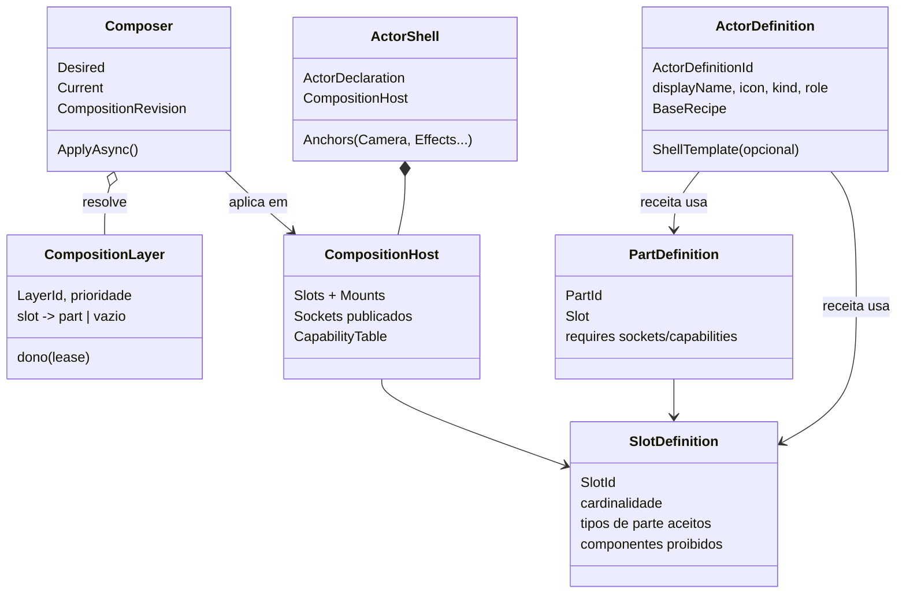
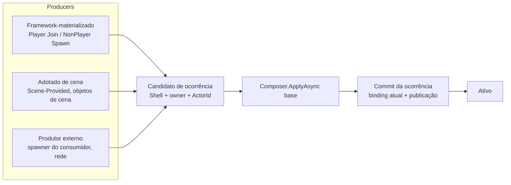
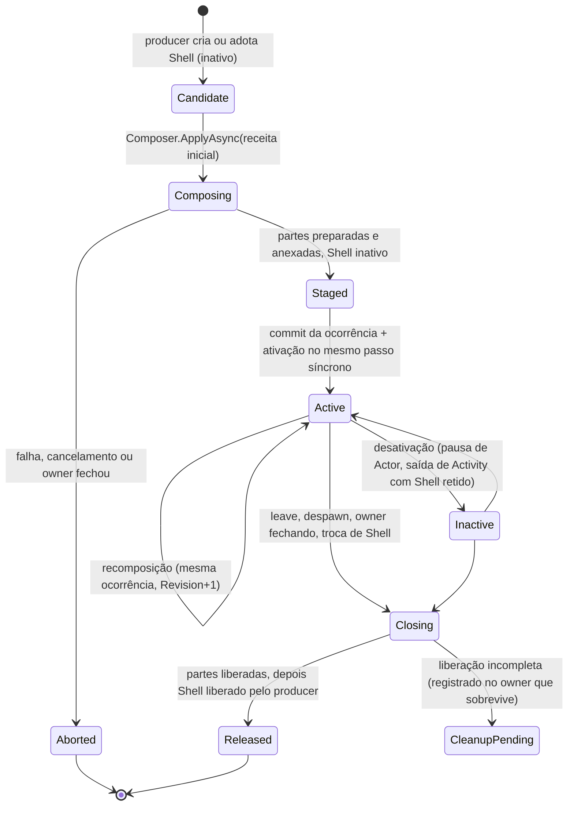
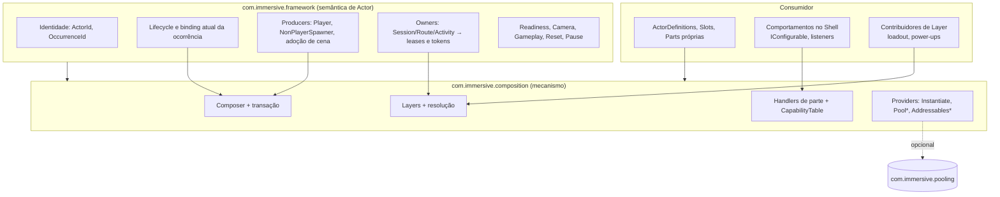

# Parecer técnico: composição dinâmica de Actors no Immersive Framework

| Item | Valor |
|---|---|
| Data | 2026-10-17 |
| Código auditado | `com.immersive.framework` master `f1a8414` (`1.2.0-preview.2`) |
| Pacotes irmãos | foundation `86b5e17` (0.2.3), pooling `8befe28` (0.2.3), audio `481f5e0` (0.2.4), logging `fe19eff` (0.2.4), consumidor `planet-devourer` `1678112` |
| Método | Leitura estática, somente leitura. Unity não foi executado, nenhum teste rodou, nada foi alterado em nenhum repositório. |
| Ordem de trabalho | A proposta das seções 2 a 8 foi formada a partir do código antes da leitura de IF-ADR-050 e IF-SPEC-050. A comparação está na seção 9. |

Referências de código usam caminhos relativos ao repositório do Framework (`Runtime/...`) com linha quando relevante.

---

## Sumário executivo

1. **Hoje não existe composição de Actor; existe uma ocorrência física de Player com um único visual opcional.** A forma do Actor é `PlayerActorRuntimeHost` (prefab definido por `LocalPlayerHostAuthoring`, um por host) mais `ActorProfile.presentationPrefab` instanciado num mount. Comportamento, animação, áudio e configuração não variam por perfil: o prefab de host é o mesmo para todos os perfis (`Runtime/PlayerParticipation/Authoring/LocalPlayerHostAuthoring.cs:44`).
2. **Qualquer mudança de perfil recria o Actor inteiro.** A troca de perfil passa por substituição de ocorrência: novo root físico, novo `ActorId` gerado por revisão de materialização (`AttachedPlayerActorMaterializationAdapter.cs:326`), liberação e readmissão de gameplay (`ActivityPlayerActorLifecycleParticipant.PreparedActorReplacement.cs:40`), e só para Slots Manager-Provisioned (`:22`).
3. **NonPlayer não tem pipeline de criação.** O Framework só publica ocorrências NonPlayer produzidas por terceiros (IF-ADR-049, `ActorOccurrencePublication`). Cada projeto teria de escrever o próprio spawner.
4. **Recomendação:** separar o Actor em **Shell** (root físico estável com identidade, âncoras e capacidades de infraestrutura) e **Composição** (conjunto de **Parts** distribuídas em **Slots**, resolvido a partir de **Layers** com donos explícitos). Um **Composer** por ocorrência aplica mudanças como **transação de estado desejado**: preparação assíncrona e inativa, commit síncrono num único frame, compensação barata porque as partes antigas são desanexadas e não destruídas até o commit, e liberação adiada.
5. **Identidade em três níveis:** `ActorId` lógico estável durante toda a participação; `ActorOccurrenceId` muda só quando o Shell muda; `CompositionRevision` muda a cada commit de composição. Substituir partes nunca muda os dois primeiros.
6. **Um único pipeline de ocorrência para três formas de participação** (materializada pelo Framework, adotada de cena, publicada por produtor externo), compartilhado por Player e NonPlayer. O que difere entre elas é quem possui o root e quais garantias de pré-ativação valem, não a composição.
7. **Pacote:** recomendo um pacote UPM de **mecanismo**, `com.immersive.composition`, sem conceito de Actor, Session ou Activity, do qual o Framework depende. A semântica de Actor (identidade, ocorrência, ownership por escopo, Player, readiness, Camera) fica no Framework. Isso inverte a direção proposta na IF-SPEC-050 e elimina uma classe inteira de contratos (descoberta de provider, sinal de "composição obrigatória" com pacote ausente, duplicação do caminho de visual do Player).
8. **Sobre IF-ADR-050/IF-SPEC-050:** concordo com a separação de identidades, com o commit condicional sem "rollback de ficção" e com a honestidade sobre componentes não cooperativos. As fragilidades principais são: o documento trata quase só do ciclo de vida de substituição A→B e deixa a composição propriamente dita (slots, precedência, binding com comportamentos, recursos assíncronos, authoring) indefinida; a direção de dependência gera contratos que só existem por causa dela; e a "autorização operacional por ocorrência" é um conceito transversal caro que o próprio texto admite não poder garantir.
9. **Riscos mais prováveis de serem esquecidos:** referências cacheadas a Transforms de partes (a Camera já cacheia o Subject em `SessionCameraAssignmentRuntime.cs:2293`), continuidade de estado do Animator, colliders dentro de partes visuais, camadas de render por jogador em split-screen, layers temporárias cujo dono termina antes do Actor, e reuso de Shell por pooling.

---

## 1. Diagnóstico da arquitetura atual

### 1.1 Mapa do que existe

| Conceito | Onde | O que faz | Limite relevante para composição |
|---|---|---|---|
| `IActor`, `ActorDeclaration`, `ActorId`, `ActorKind`, `ActorRole` | `Runtime/Actors/` | Identidade declarada num MonoBehaviour no root | Não possui ciclo de vida, materialização nem composição (documentado nos próprios tipos). |
| `ActorProfile` | `Runtime/Actors/ActorProfile.cs` | Opção selecionável: id, nome, ícone, kind, role, **um** `presentationPrefab` | Uma única variação, só visual. Validação de materialização aceita apenas `Player/Protagonist` (`AttachedPlayerActorMaterializationAdapter.cs:281`). |
| `PlayerActorRuntimeHost` | `Runtime/PlayerParticipation/Authoring/PlayerActorRuntimeHost.cs` | Root físico do Player Actor com `PlayerActorDeclaration` e um mount opcional de visual | É, na prática, o "Shell". Só existe para Player. Proíbe `PlayerInput` e declarações extras no visual (boa regra, específica demais). |
| `LocalPlayerHostAuthoring` | `Runtime/PlayerParticipation/Authoring/LocalPlayerHostAuthoring.cs:32-44` | Dono de `PlayerInput`, `ActorMount` e do prefab de Runtime Host | O prefab de Shell é por host, não por perfil: todos os perfis compartilham o mesmo comportamento. |
| `AttachedPlayerActorMaterializationAdapter` | `Runtime/PlayerParticipation/Runtime/` | Instancia Shell e visual sob um staging inativo, gera identidade, registra no RuntimeContent | Instancia direto (`:102`, `:121`) em vez de usar `IRuntimeMaterializationAdapter`. Síncrono. Gera `ActorId` novo a cada revisão (`:326`). |
| `PlayerActorMaterializationHandle` | idem | Estado físico (StagedInactive, Active, Release*) | Ativa visual e Shell juntos (`:126-127`). Visual é imutável após materialização. |
| Prepared Actor Replacement | `ActivityPlayerActorLifecycleParticipant.PreparedActorReplacement.cs` | Troca de perfil por nova ocorrência | Libera gameplay e ocupação antes da troca física e reprojeta depois. Só Manager-Provisioned. |
| `ActorOccurrence*` (IF-ADR-049) | `Runtime/Actors/References/` | Publicação e resolução de ocorrência, seletores por Slot ou `ActorId`+owner, eventos de troca | Bom vocabulário de ocorrência. Publicação NonPlayer é manual (`ActorOccurrencePublicationScope`). Não há conceito de mudança de conteúdo sem troca de ocorrência. |
| `RuntimeContent*` | `Runtime/RuntimeContent/` | Owner (`Session/Route/Activity/Transient`), escopo, token de cancelamento passivo, handles lógicos, adapters de materialização/liberação | Vocabulário de ownership bom e reutilizável. Adapters síncronos, recurso descrito por strings, sem lease/ref-count, sem async. |
| `ActorCameraSubjectAuthoring` | `Runtime/Actors/ActorCameraSubjectAuthoring.cs` | Transform de observação explícito, deve estar dentro do root | Se a observação ficar dentro de uma parte trocável, a Camera fica com referência pendente (ver 7, E3). |
| `PlayerGameplayInputReader` e admissão de gameplay | `Runtime/PlayerParticipation/` | Endpoint de input no Actor, vinculado por token de admissão | Exemplo de "capacidade vinculada pelo Framework": modelo bom a generalizar. |
| `Resettable`, `ResetComposition` | `Runtime/Reset/Unity/` | Unidades de Reset registradas por transações com owner | Partes que entram e saem em runtime não têm política de Reset definida. |
| Participantes (`ParticipantExecutor`, `ISceneLifecycleParticipant`, readiness) | `Runtime/Common`, `SceneLifecycle`, `ActivityFlow` | Execução ordenada com agregação de issues; descoberta limitada a raiz | Precedente reaproveitável para handlers de partes e para readiness da composição inicial. |
| Pacotes irmãos | pooling (`IPoolService`, `IPoolable`), audio (cues, serviços), foundation (FSM, EventBus) | Infraestrutura técnica | Pooling serve como provider de instâncias de partes. Audio não precisa conhecer composição. |

### 1.2 Como a "composição" funciona hoje (Player)

```text
PlayerSlotProfile.defaultActorProfile ──► seleção (Session)
                                              │
LocalPlayerHostAuthoring.playerActorRuntimeHostPrefab (um por host)
                                              │
AttachedPlayerActorMaterializationAdapter.TryMaterialize
   staging inativo ─► Instantiate(Shell) ─► Instantiate(ActorProfile.presentationPrefab, mount)
   ─► ActorId = "player-actor:{session}:{scope}:{owner}:{slot}:{revisão}"
   ─► RuntimeContent handle "Materialized" ─► handle StagedInactive
                                              │
PlayerActorMaterializationHandle.TryActivate ─► visual.SetActive + Shell.SetActive
                                              │
Troca de perfil = nova materialização completa + release/readmissão de gameplay
```

O consumidor de exemplo confirma o modelo: `FG_PlayerActor.prefab` contém `PlayerActorDeclaration`, `PlayerActorRuntimeHost`, `ActorCameraSubjectAuthoring`, `PlayerGameplayInputReader`, movimento e look, além de `VisualContentMount` e `CameraMount`. Os perfis `ActorProfile_Cow` e `ActorProfile_Farmer` diferem só em `presentationPrefab`.

### 1.3 Limitações reais

| # | Limitação | Evidência | Consequência para a intenção |
|---|---|---|---|
| L1 | Composição fixa em dois níveis e um só tipo de parte (prefab visual) | `ActorProfile.cs:38`, `PlayerActorRuntimeHost.cs` | Animações, efeitos, áudio, configuração de comportamento não têm onde viver por perfil. |
| L2 | Comportamento não varia por perfil | `LocalPlayerHostAuthoring.cs:44` | Para "Cow anda diferente de Farmer" o consumidor precisa de hacks ou de outro host. |
| L3 | Nenhuma substituição parcial | Handle guarda `VisualContent` imutável (`PlayerActorMaterializationHandle.cs:84`) | Trocar o visual exige recriar o Actor e perder estado (pose, velocidade, vida, buffs). |
| L4 | `ActorId` regenerado por materialização | `AttachedPlayerActorMaterializationAdapter.cs:326` | Identidade lógica e encarnação se confundem; referências por `ActorId` não sobrevivem a uma troca. |
| L5 | Troca de perfil derruba gameplay | `PreparedActorReplacement.cs:40` | Janela sem controle, readmissão, reconciliação de Camera, custo de código alto (o arquivo de reconcile do participante tem 1768 linhas). |
| L6 | Só Manager-Provisioned pode trocar | `PreparedActorReplacement.cs:22` | Scene-Provided e NonPlayer não têm caminho. |
| L7 | NonPlayer sem produtor do Framework | `ActorOccurrencePublication.cs:31` aceita só NonPlayer publicado externamente | Duplicação de spawners entre projetos; ownership e publicação ficam com o consumidor. |
| L8 | Materialização síncrona e por `Instantiate` direto | `IRuntimeMaterializationAdapter.cs:18`, `AttachedPlayer...:102,121` | Sem Addressables, sem pré-carga, sem pooling, sem pré-aquecimento por Activity. |
| L9 | Nenhum contrato de rebinding entre partes | Movimento no Shell, Animator no visual, Camera no Shell | Ao trocar o visual, quem dirige o Animator perde a referência; não há notificação. |
| L10 | Camera cacheia o Subject resolvido | `SessionCameraAssignmentRuntime.cs:2293`, invalidação só por `CurrentActorInvalidated` (`:2236`) | Uma troca de conteúdo sem troca de ocorrência deixaria a Camera com Transform destruído se a observação estiver dentro da parte. |
| L11 | Token de cancelamento é passivo | `RuntimeScopeCancellationToken.AllowsMaterialization` | Não cancela trabalho assíncrono em andamento; só é checado antes do efeito. |
| L12 | Custo de superfície por feature | `Runtime/PlayerParticipation` tem cerca de 47 mil linhas, muitos tipos de evidência por operação | Uma composição modelada no mesmo estilo tende a multiplicar tipos e estados. É um risco de manutenção, não só estético. |

### 1.4 O que reaproveitar, evoluir ou substituir

| Elemento | Decisão | Motivo |
|---|---|---|
| `RuntimeContentOwner` e escopos Session/Route/Activity | Reaproveitar como vocabulário de ownership do lado do Framework | Já é a fonte de verdade de "quem vive quanto". |
| `RuntimeScopeCancellationToken` | Evoluir: ponte para `System.Threading.CancellationToken` acionado quando o escopo entra em cancelamento | Preparação assíncrona precisa de cancelamento ativo. |
| `IRuntimeMaterializationAdapter` / `RuntimeMaterializationResource` (strings) | Substituir, no caminho de Actor, por providers tipados de instância e de asset do pacote de composição | Strings não carregam tipo nem dependências; o caminho de Player já contorna essa interface. |
| `PlayerActorRuntimeHost` | Evoluir para `ActorShell` genérico (Player e NonPlayer) | Já é o Shell; falta generalizar mounts, sockets e âncoras. |
| `ActorProfile` | Evoluir para `ActorDefinition` com receita base | Mantém id, nome, ícone, kind, role; `presentationPrefab` migra para uma parte no slot Visual. |
| Staging inativo e ativação explícita | Reaproveitar | Instanciar sob pai inativo adia `Awake`; é a base da preparação sem efeitos. |
| `ActorOccurrence*` (IF-ADR-049) | Reaproveitar e estender com evento de mudança de composição | Já distingue ocorrência e resolução. |
| Tokens de admissão de gameplay e `PlayerGameplayInputReader` | Reaproveitar como padrão de "capacidade vinculada pelo Framework" | Evita inventar um sistema de autorização paralelo. |
| `ParticipantExecutor`, descoberta limitada a raiz (IF-ADR-040) | Reaproveitar para ordenar handlers de partes e agregar issues | Precedente já certificado. |
| Prepared Actor Replacement | Reduzir: vira caso raro (troca de Shell); troca de perfil com mesmo Shell vira recomposição | Remove a maior parte do código de release/restauração de gameplay. |
| `ActorSet`, `ActorValidator`, readiness legada (PL-15 da auditoria de 12/10) | Remover | Sem uso no consumidor; confunde o modelo. |
| `com.immersive.pooling` | Reaproveitar como provider opcional de instâncias de partes | Já tem `IPoolable` e escopo de pool. |

---

## 2. Requisitos derivados da intenção

1. Uma parte do Actor pode ser trocada sem destruir o root, sem mudar a identidade lógica e sem perder estado que não pertence à parte.
2. A composição inicial é preparada antes da ativação e pode participar do readiness de entrada da Activity.
3. Fontes diferentes contribuem para a composição (seleção do jogador, loadout, efeito temporário de uma Activity, regra do projeto) e a precedência entre elas é explícita.
4. Quem contribui é dono do que contribui; quando o dono termina, a contribuição sai sozinha.
5. Falhas antes do commit não alteram o Actor; falhas depois do commit são relatadas sem fingir rollback.
6. Recursos (assets e instâncias) têm liberação explícita, compatível com Addressables e pooling.
7. Componentes do Actor sabem quando a composição muda e conseguem se religar sem `GetComponentInChildren` global.
8. Funciona para Player e NonPlayer, para Actors materializados pelo Framework, adotados de cena e produzidos por terceiros.
9. Authoring Unity: assets editáveis no Inspector, validação no Editor, pré-visualização.
10. O consumidor estende tipos de parte sem tocar no Framework.

---

## 3. Alternativas consideradas

| Alternativa | Descrição | Prós | Contras | Veredito |
|---|---|---|---|---|
| A. Status quo ampliado | Mais campos em `ActorProfile` (vários prefabs), troca sempre por nova ocorrência | Barato, sem conceito novo | Não atende o requisito 1; perde estado; mantém L4, L5 | Rejeitada |
| B. Prefab completo por variante + transferência de estado | Cada variante é um prefab de Actor inteiro; trocar = recriar e copiar estado (snapshot/restore) | Authoring 100% Unity, modelo mental simples | Identidade churn, custo de recriação, cada componente precisa serializar seu estado, Camera e input religam a cada troca | Rejeitada como modelo geral; serve só para troca de Shell |
| C. Shell + Slots + Parts + Layers com transação (recomendada) | Root estável, partes trocáveis por slot, receitas em camadas com dono, Composer transacional | Atende todos os requisitos; troca local; ownership explícito; extensível por tipo de parte | Conceitos novos; exige disciplina de "o que vive no Shell"; precisa de bom authoring | **Recomendada** |
| D. Modelo de dados puro (estilo ECS) com apresentação derivada | Actor é dado; visual é projeção reconstruída | Excelente para rede e save | Distante do fluxo GameObject/Inspector do ecossistema; reescreve gameplay do consumidor | Rejeitada |
| E. Só ganchos no Framework | Framework expõe `IActorCompositionParticipant` e o consumidor faz o resto | Mínimo no Framework | Duplicação entre projetos, sem garantias de lifecycle, sem authoring comum | Rejeitada |
| F. Sistema de modificadores de atributos como composição | Composição = stats e modificadores | Útil para buffs | Atributos são domínio de gameplay; misturar com instâncias de conteúdo confunde ownership | Fora do escopo; as Layers de C servem de base para um sistema desses no consumidor |

Para C ainda havia duas variantes de semântica de mudança:

- **C1, contribuições independentes com revisão própria** (cada contribuição avança, com geração de operação e revisão local). Flexível, mas cada par de contribuições pode ficar em combinação não testada e o número de estados cresce rápido.
- **C2, reconciliação de estado desejado** (há uma composição desejada por Actor; o Composer calcula o diff até ela e aplica o grupo inteiro num commit, com uma única `CompositionRevision`). Menos estados, combinações sempre coerentes, cancelamento natural ("o alvo mudou, replaneja"). **Recomendo C2.**

---

## 4. Proposta arquitetural recomendada

### 4.1 Princípios

1. **O Shell é estável; a composição é substituível.** Tudo a que sistemas externos guardam referência (pose, física de locomoção, `ActorDeclaration`, endpoint de input, âncora de Camera, `Resettable` do Actor) vive no Shell ou é exposto por âncora estável.
2. **Uma autoridade por fato.** Producer é dono do Shell. Composer é dono das instâncias de partes. Provider é dono do asset carregado. Contribuidor é dono da sua Layer. Framework é dono da identidade e do binding atual da ocorrência.
3. **Preparar não tem efeito; commit é síncrono; liberar é adiado.** Nada preparado é visível ou ativo; o commit acontece inteiro dentro de um frame; o que saiu só é destruído ou devolvido ao pool depois do commit.
4. **Desanexar antes de destruir.** As partes antigas ficam vivas e inativas até o commit terminar, então a compensação de uma falha é reanexá-las, não recriá-las.
5. **Estado desejado, não fila de comandos.** Pedidos mudam o alvo; o Composer converge para o alvo mais recente.
6. **Nada de descoberta global.** Handlers e capacidades são encontrados dentro do Shell e registrados explicitamente.

### 4.2 Modelo conceitual



| Termo | Significado |
|---|---|
| **ActorDefinition** | Evolução de `ActorProfile`. Opção selecionável com identidade estável, metadados de UI, `kind`/`role`, Shell opcional e **receita base** (slot para parte). |
| **ActorShell** | Root físico de uma ocorrência. Generaliza `PlayerActorRuntimeHost` para Player e NonPlayer. Contém `ActorDeclaration`, `CompositionHost` e âncoras. |
| **SlotDefinition** | Asset que nomeia um ponto de variação (Visual, Animação, Locomoção, Arma, Áudio, VFX, Configuração de IA). Declara cardinalidade (uma ou várias partes), tipos aceitos e componentes proibidos (por exemplo `PlayerInput`, `ActorDeclaration`). |
| **Mount / Socket** | Mount é o Transform do Shell onde um slot instancia conteúdo. Socket é um ponto publicado por uma parte (por exemplo a mão do visual) que outras partes podem exigir. |
| **PartDefinition** | Asset polimórfico (ScriptableObject) que descreve uma contribuição. Tipos de base: `PrefabPart`, `AnimatorControllerPart`, `DataPart<T>`. O consumidor cria os seus. |
| **Part handler** | Código que sabe preparar, anexar, desanexar e liberar um tipo de parte. Registrado por tipo de `PartDefinition`. |
| **CompositionLayer** | Mapa slot para parte (ou "vazio explícito") com prioridade e dono. Exemplos: Base (definição), Selection (jogador), Loadout, Activity (efeito de fase), Temporary (power-up). |
| **Composer** | Uma instância por ocorrência. Resolve Layers em composição desejada, calcula diff, executa a transação, mantém `Current` e `CompositionRevision`, notifica. |
| **CapabilityTable** | Registro local ao Shell de capacidades expostas por partes (`Animator`, sockets, `IConfigurable<T>`), com eventos de troca. Substitui buscas por hierarquia. |

### 4.3 Identidade

| Identidade | Muda quando | Dono | Uso |
|---|---|---|---|
| `ActorDefinitionId` (hoje `ActorProfileId`) | Nunca em runtime | Authoring | Seleção, save, catálogo |
| `ActorId` | Nunca durante a participação lógica (para Player: a participação do Slot na Session; para NonPlayer: o pedido de spawn ou a declaração de cena) | Framework | Referências de gameplay que devem sobreviver a trocas |
| `ActorOccurrenceId` | Quando o Shell é recriado ou um Shell de pool é reutilizado | Framework | Referências exatas a uma encarnação física |
| `CompositionRevision` | A cada commit de composição bem-sucedido | Composer | Concorrência otimista (`expectedRevision`), invalidação de caches, save |
| `PartInstanceId` | A cada instância de parte anexada | Composer | Diagnóstico, liberação, pooling |

Mudança necessária: parar de gerar `ActorId` por revisão de materialização (L4). A unicidade por encarnação passa a ser responsabilidade de `ActorOccurrenceId`, que já existe.

### 4.4 Formas de criação e participação



| Forma | Quem possui o Shell | Garantia de pré-ativação | Composição inicial |
|---|---|---|---|
| Framework-materializado (Player Manager-Provisioned, novo `NonPlayerSpawner`) | Framework, sob `RuntimeContentOwner` | Forte: Shell e partes nascem sob pai inativo | Preparada antes da ativação; entra no readiness |
| Adotado de cena (Scene-Provided, NonPlayer de cena) | Escopo da cena | Fraca: o objeto pode já ter rodado `Awake`/`OnEnable` | Partes já presentes na cena são registradas como **partes adotadas** (não liberadas pelo Composer); o resto da receita é aplicado na adoção |
| Produtor externo | O produtor | Declarada pelo produtor | O produtor chama o mesmo pipeline; publicação automática após commit |

O Framework passa a ter um produtor NonPlayer genérico (owner-scoped, compatível com pooling), o que remove a duplicação de spawners entre projetos. `ActorOccurrencePublicationScope` continua existindo para produtores externos.

### 4.5 Lifecycle da ocorrência



Regras:

- Ordem de liberação: Composer fecha primeiro (cancela preparação em curso, desanexa em ordem inversa de dependência, libera instâncias e leases), depois o producer libera o Shell. A ocorrência deixa de ser resolvível no início de `Closing`.
- `Staged → Active` é síncrono: o binding atual muda, o Shell ativa, os eventos de publicação saem, tudo no mesmo frame. Não existe frame em que o Actor é atual e inativo, nem ativo e não atual.
- Readiness de gameplay continua ortogonal (já é assim no Framework).

### 4.6 Transação de composição

```mermaid
sequenceDiagram
    participant Req as Contribuidor
    participant Cmp as Composer
    participant H as Part handlers
    participant P as Providers (asset/instância)
    participant L as Listeners do Actor
    Req->>Cmp: SetLayer(...) / ApplyAsync(expectedRevision?)
    Cmp->>Cmp: resolve Layers → Desired; diff com Current; fecha dependências (sockets)
    Cmp->>H: Prepare(parte nova) em paralelo
    H->>P: carregar asset / alugar instância (pai inativo)
    P-->>H: preparado (sem Awake)
    Note over Cmp: se Desired mudou: replaneja reaproveitando o já preparado
    Cmp->>L: OnCompositionChanging(delta)
    Cmp->>H: Detach(antigas) em ordem inversa
    Cmp->>H: Attach(novas) em ordem de dependência (reparent, layer, SetActive)
    Cmp->>Cmp: CapabilityTable atualizada, Revision+1
    Cmp->>L: OnCompositionChanged(delta)
    Cmp->>H: Release(antigas) no fim do frame (pool ou Destroy)
```

**Preparação (assíncrona, cancelável).**
- Usa `Awaitable` e `CancellationToken` (o Framework já usa `Awaitable` em GameFlow e SceneLifecycle). O token é ligado ao escopo do owner e ao fechamento da ocorrência.
- Instâncias nascem sob um staging inativo dentro do Shell; `Awake` não roda.
- Pedidos novos durante a preparação mudam o alvo. O Composer recalcula o diff e reaproveita o que já preparou para partes que continuam no alvo; descarta o resto.
- Validação antes de qualquer efeito: slot existe no Shell, tipo aceito, sockets exigidos serão providos, componentes proibidos ausentes, ciclos de dependência rejeitados.

**Commit (síncrono, um frame, compensável).**
1. `OnCompositionChanging(delta)` para listeners (soltar referências, capturar estado).
2. Captura de estado das partes que têm handler de transferência (`IPartStateTransfer`, por exemplo parâmetros e tempo normalizado do Animator).
3. `Detach` das partes que saem, em ordem inversa de dependência. Elas ficam inativas e vivas.
4. `Attach` das novas em ordem de dependência: reparent para mount ou socket, camada de render herdada do Shell, `SetActive(true)`.
5. Restauração de estado transferido, atualização da `CapabilityTable`, `CompositionRevision + 1`.
6. `OnCompositionChanged(delta)`.
7. Partes antigas entram na fila de liberação de fim de frame.

Se o passo 4 lançar exceção na parte *k*: desanexar as *k−1* novas, reanexar as antigas (ainda vivas), não incrementar revisão, devolver `FailedCompensated`. Se a reanexação também falhar: estado `Faulted`, gameplay do Actor bloqueado pelo mecanismo de disponibilidade já existente, diagnóstico com a lista de partes afetadas. Não há promessa de desfazer efeitos de `Awake`/`OnEnable` das novas partes; por isso o contrato de parte exige que esses callbacks só façam inicialização local.

**Ponto de commit.** Padrão `Immediate` (no retorno da preparação). Opções `NextFrame` e `UnderCoverage` (durante cobertura de Transition, reaproveitando o Gate de Transition existente) para trocas grandes, por exemplo durante entrada de Activity.

**Concorrência.** Um Composer, uma transação em execução. `expectedRevision` opcional para quem precisa de concorrência otimista (UI de seleção). Sem locks durante esperas assíncronas.

### 4.7 Layers, precedência e autoridade

```text
Temporary (power-up, dono = item/efeito)          prioridade 400
Activity (regra da fase, dono = Activity owner)   prioridade 300
Loadout (equipamento, dono = sistema do jogo)     prioridade 200
Selection (escolha do jogador, dono = Session)    prioridade 100
Base (ActorDefinition)                            prioridade 0
```

- Resolução por slot: vence a Layer de maior prioridade que tem entrada para o slot. "Vazio explícito" remove a parte do slot.
- Cada Layer é criada com um **lease de dono**. No Framework, o dono é um `RuntimeContentOwner` ou um objeto Unity; quando o escopo fecha ou o objeto é destruído, a Layer é removida e o Composer reconcilia. Isso resolve o caso "power-up da Activity num Player que pertence à Session" sem código do consumidor.
- Selecionar outro `ActorDefinition` com o mesmo Shell troca a Layer Base (e Selection) e vira recomposição: mesma ocorrência, mesmo `ActorId`, gameplay mantido. Só quando o Shell difere o Framework faz substituição de ocorrência (seção 4.10, A→B).
- Quem pode escrever: qualquer código que tenha o handle da Layer que criou. Ninguém escreve na Layer de outro. O Composer é o único que aplica.

### 4.8 Binding com comportamentos

O problema L9 se resolve com três mecanismos, em ordem de preferência:

1. **Âncoras estáveis no Shell.** Camera Subject, origem de VFX e de áudio 3D ficam em Transforms do Shell. Uma parte pode publicar um socket e o Shell pode seguir esse socket por constraint, mas quem fora do Actor guarda referência guarda a âncora, não o socket.
2. **CapabilityTable local.** Partes publicam capacidades ao serem anexadas (o `Animator` do visual, o socket `hand.right`, a config `LocomotionConfig`). Componentes do Shell consultam `TryGet<T>(out T)` e assinam `Changed<T>`. Nada de `GetComponentInChildren` em todo frame.
3. **`DataPart<T>` e `IConfigurable<T>`.** Configuração de comportamento (velocidade, aceleração, perfil de IA, tabela de sons) chega como ScriptableObject aplicado a quem implementa `IConfigurable<T>` no Shell. Trocar a config não instancia nada.

Contrato para componentes dentro de partes (`IPartLifecycle`, opcional): `OnAttached(context)` e `OnDetached()` para assinar e desassinar eventos, registrar em serviços e voltar ao estado neutro antes do pool. `Awake`/`OnEnable` limitados a inicialização local.

### 4.9 Recursos e liberação

| Camada | Dono | Liberação |
|---|---|---|
| Asset (prefab, controller, clip) | Provider de asset (`Direct` por referência serializada; `Addressables` opcional) com lease ref-counted | Quando o último lease termina, ou quando o escopo de pré-carga fecha |
| Instância de parte | Composer, via provider de instância (`Instantiate` ou `Pool`) | Fim do frame após o detach: `Destroy` ou devolução ao pool (`IPoolable.OnReturnedToPool`) |
| Conjunto de pré-carga | Activity ou Route (`RuntimeContentOwner`) | Fechamento do escopo |
| Layer | Contribuidor | Fechamento do dono ou remoção explícita |
| Shell | Producer | Depois do Composer fechar |

Pré-carga: uma Activity pode declarar "pré-aqueça estas `ActorDefinition`/partes" para que trocas durante o jogo sejam síncronas na prática. Isso entra no readiness de entrada como participante.

Resultado de liberação com três valores apenas: `Released`, `Pending` (o provider ainda não confirmou, por exemplo descarregamento assíncrono), `Failed`. `Destroy` agendado conta como `Released` para instâncias Unity; a distinção mais fina fica nos diagnósticos do provider, não no contrato geral.

### 4.10 Substituição de ocorrência (troca de Shell)

Continua necessária quando o Shell muda (por exemplo, um veículo virar personagem). Recomendo manter o desenho de "A continua atual enquanto B é preparado" e fazer o handoff assim:

1. B é criado como candidato, inativo, e composto (`Composing → Staged`).
2. Num único passo síncrono: revalidar A, owner e revisão esperada; desativar A; transferir pose e estado do Shell (`IShellStateTransfer`, opcional); commit do binding para B; ativar B; publicar; mover o vínculo de gameplay (token de admissão) de A para B.
3. A entra em `Closing`.

Como o passo 2 é síncrono, não há janela em que A e B estão ambos ativos nem frame sem Actor, o que dispensa um sistema geral de "autorização operacional por ocorrência". Quem precisa de gate (input, gameplay) já tem os gates do Framework.

### 4.11 Matriz de falhas

| Caso | Estado resultante | Compensação |
|---|---|---|
| Asset não carrega / parte inválida na preparação | Composição atual intacta; pedido `Rejected` com issues por parte | Preparados descartados; leases devolvidos |
| Owner do Actor fecha durante preparação | Ocorrência em `Closing`; transação `Cancelled` | Token cancela providers; resultados tardios são descartados e liberados por quem os criou |
| Dono de uma Layer fecha durante preparação | Alvo recalculado | Replanejamento com reaproveitamento |
| Exceção no `Attach` | `FailedCompensated`, revisão não muda | Antigas reanexadas |
| Exceção na reanexação | `Faulted`, gameplay do Actor bloqueado | Diagnóstico; política de retry ou release definida pelo producer |
| Listener lança em `OnCompositionChanged` | Commit mantido | Exceção registrada, demais listeners recebem (mesmo padrão de `ActorOccurrenceReferenceBinding.Dispatch`) |
| Liberação de instância falha | Commit mantido; `CleanupPending` no Composer | Retry na próxima liberação ou no fechamento |
| Troca de Shell falha antes do commit | A continua atual e ativo | B liberado |
| Falha depois do commit de B | B atual, readiness degradado | Sem reconstruir A |
| Destruição externa do Shell | Ocorrência invalidada | Composer libera leases; instâncias destruídas com o Shell |

### 4.12 Authoring Unity

- `ActorDefinition` com Inspector de receita: lista slot para parte, validada contra um Shell de referência (slots existentes, sockets exigidos, componentes proibidos). Erros aparecem no asset, não em runtime.
- `ActorShell` com Inspector que lista slots, mounts, âncoras e mostra a composição atual em Play Mode (revisão, partes, donos das Layers).
- Pré-visualização: botão "Preview" que compõe a definição numa cena de preview do Editor, sem Play Mode.
- Migração automática: `ActorProfile.presentationPrefab` vira `PrefabPart` no slot `Visual` (menu de migração no estilo dos já existentes).
- `SlotDefinition` e `PartDefinition` são assets com id textual estável (mesmo padrão de `ActorProfileId`) para save e rede, e um catálogo opcional resolve id para asset.

### 4.13 Diagrama de responsabilidades



---

## 5. Modularização e avaliação da preferência por pacote UPM

| Opção | Descrição | Avaliação |
|---|---|---|
| 1. Tudo dentro do Framework (assembly separado) | `Immersive.Framework.Actors.Composition` | Menor custo de release. Risco de o mecanismo absorver conceitos de Session/Activity e não ser reutilizável. |
| 2. Pacote **acima** do Framework (direção da IF-SPEC-050) | `com.immersive.actor-composition` depende do Framework | O Framework não pode usar composição para o próprio Player (o visual atual continuaria como mecanismo paralelo). Obriga o Core a definir seam de descoberta e sinal de "composição obrigatória" para detectar pacote ausente. Não serve para objetos que não são Actor. |
| 3. Pacote de **mecanismo abaixo** do Framework (recomendado) | `com.immersive.composition` depende só de foundation e logging; Framework depende dele | Framework usa a mesma composição para Player e NonPlayer; não existe "pacote ausente"; o mecanismo serve também para veículos, armas, props, avatares de UI; testável sem Framework. Custo: mais uma dependência do Framework e coordenação de versões, que o ecossistema já pratica. |

**Recomendação: opção 3**, com uma regra de fronteira escrita: o pacote não contém as palavras Actor, Session, Route, Activity, Player, nem referência a `RuntimeContentOwner`. Ele recebe um `CancellationToken` e um "dono de lease" abstrato; o Framework faz a ponte com seus owners.

Assemblies propostos:

```text
com.immersive.composition
  Immersive.Composition            (núcleo: Slot, Part, Layer, Composer, Host, handlers, providers Direct/Instantiate)
  Immersive.Composition.Editor     (Inspectors, validação, preview, migração)
  Immersive.Composition.Pooling    (versionDefines com.immersive.pooling)
  Immersive.Composition.Addressables (versionDefines com.unity.addressables)
  dependências: com.immersive.foundation, com.immersive.logging

com.immersive.framework
  + Immersive.Framework.Actors (ActorDefinition, ActorShell, lifecycle de ocorrência, producers, pontes de owner)
  dependência nova: com.immersive.composition

com.immersive.audio
  sem mudança obrigatória. Uma AudioCueSetPart, se desejada, fica num assembly opcional
  do pacote de composição ou no consumidor; o áudio não deve conhecer composição.
```

Risco desta escolha: desenhar um mecanismo genérico sem um segundo consumidor real. Mitigação: validar o desenho contra dois casos desde o início (Player do Framework e um objeto não-Actor do consumidor, por exemplo uma arma com skins).

---

## 6. Mudanças necessárias

### 6.1 Framework

| # | Mudança | Notas |
|---|---|---|
| F1 | `ActorId` lógico estável; `ActorOccurrenceId` como identidade de encarnação | Remove o sufixo de revisão (`AttachedPlayerActorMaterializationAdapter.cs:326`). Reconciliar IF-ADR-049 e o seletor por `ActorId`. |
| F2 | `ActorShell` genérico | Evolução de `PlayerActorRuntimeHost`; `PlayerActorDeclaration` mantém a evidência de `PlayerInput`. Validações atuais de "nada de PlayerInput no visual" viram regras de `SlotDefinition`. |
| F3 | Lifecycle de ocorrência compartilhado (candidato, commit, publicação, fechamento) | Player passa a ser cliente desse lifecycle; a materialização sai de `PlayerParticipation`. |
| F4 | `ActorProfile` → `ActorDefinition` com receita base | Migração automática do `presentationPrefab`. Remover a restrição `Player/Protagonist` do caminho genérico. |
| F5 | Seleção com mesmo Shell vira recomposição | Mantém gameplay admitido; elimina a restrição Manager-Provisioned para esse caso; Prepared Actor Replacement fica só para troca de Shell, com handoff síncrono (4.10). Exige emenda à IF-ADR-024. |
| F6 | Camera ligada a âncora do Shell e ao evento de composição | `SessionCameraAssignmentRuntime` deve reconciliar também em `CompositionChanged` quando o Subject vier de socket. |
| F7 | `NonPlayerSpawner` owner-scoped, com pooling opcional | Publicação automática; `ActorOccurrencePublicationScope` fica para produtores externos. |
| F8 | Ponte de owner para composição | `RuntimeContentOwner` → lease de Layer e `CancellationToken` ativo; o token passivo atual continua para checagens síncronas. |
| F9 | Readiness da composição inicial e da pré-carga | Participante de readiness para Actors materializados na entrada da Activity. |
| F10 | Reset | Capacidade "resetar composição para Base+Selection" no `Resettable` do Shell; Layers de escopo Activity somem com o escopo. Partes não são subjects de Reset por padrão. |
| F11 | Pause | Partes anexadas durante pausa recebem o estado de pausa (capability de pausa no Shell). |
| F12 | Remover legado PL-15 (`ActorSet`, `ActorValidator`, readiness de Actor) | Simplifica o namespace antes de crescer. |
| F13 | Descritor serializável de composição (Layers com ids de parte e dono) | Gancho para Progression Save e rede, sem o Save ser dono da composição. |

### 6.2 Pacotes

- Criar `com.immersive.composition` (seção 5).
- `com.immersive.pooling`: nenhuma mudança obrigatória. Útil ter `Rent` sob pai inativo garantido (verificar comportamento de `GameObjectPool.Rent` com `SetActive`), porque a preparação sem `Awake` depende disso.
- `com.immersive.audio`, `logging`, `foundation`: sem mudança.

### 6.3 Consumidor (`planet-devourer`)

- `FG_PlayerActor.prefab` vira Shell com slots `Visual` e, quando necessário, `Locomotion` (config).
- `ActorProfile_Cow`/`Farmer` viram `ActorDefinition` com receita.
- `MinimalPlayerMovement` e afins implementam `IConfigurable<LocomotionConfig>` em vez de campos fixos, o que permite comportamento por definição.

### 6.4 Ordem sugerida (sem iniciar implementação)

1. Decisões de identidade (F1) e direção de pacote (seção 5), porque mudam contratos publicados.
2. Núcleo do pacote de composição com `PrefabPart` e `DataPart<T>`, provider Direct/Instantiate, validação no Editor.
3. Framework: `ActorShell`, lifecycle compartilhado, migração do visual do Player.
4. Recomposição na seleção (F5) e Camera (F6).
5. `NonPlayerSpawner`, pooling, Addressables, pré-carga.
6. Authoring avançado (preview, inspeção em Play Mode).

---

## 7. Problemas, riscos e casos extremos

| # | Caso | Por que importa | Tratamento proposto |
|---|---|---|---|
| E1 | Continuidade do Animator ao trocar visual | Estado e parâmetros se perdem; pulo visual | `IPartStateTransfer` opcional; controller como parte separada do mesh quando possível |
| E2 | Partes que dependem de sockets de outras (arma na mão do visual) | Trocar o visual invalida a arma | Fecho de dependências no diff: a arma é reanexada no mesmo commit |
| E3 | Referências cacheadas fora do Actor | A Camera já guarda o Subject resolvido (`SessionCameraAssignmentRuntime.cs:2293`) | Âncoras no Shell; reconciliação em `CompositionChanged` |
| E4 | Colliders e Rigidbody dentro de partes | Mudança de forma no meio do passo de física | Autoridade física no Shell; partes com colliders declaram slot "Collision" com ponto de commit `NextFrame` |
| E5 | `Awake`/`OnEnable` com efeitos globais em prefabs de parte | Efeitos irreversíveis antes do commit ou repetidos no pool | Instanciar sob pai inativo; contrato `IPartLifecycle`; validação de componentes proibidos |
| E6 | Vazamento de inscrições em eventos | Parte destruída continua recebendo callbacks | `OnDetached` obrigatório para quem assina; diagnóstico em modo de desenvolvimento |
| E7 | Pedido durante preparação; Actor fechado durante preparação; Activity saindo | Resultados tardios aplicados no Actor errado | Estado desejado + token ligado ao owner e à ocorrência |
| E8 | Falha parcial de carregamento assíncrono | Composição incoerente | Preparação tudo-ou-nada por transação; nada aplicado sem todas as partes prontas |
| E9 | Transições visuais (dissolve, crossfade) | Precisa do antigo e do novo vivos ao mesmo tempo | Liberação adiada com "presentation handoff": o antigo fica sob controle do efeito até terminar, sem voltar a ser parte atual |
| E10 | Layer cujo dono termina antes do Actor | Power-up de Activity num Player de Session | Lease de dono remove a Layer e reconcilia |
| E11 | Split-screen e câmeras por jogador | Braços em primeira pessoa visíveis só para o dono; layers de culling | Shell define camada de render e o handler propaga para as partes |
| E12 | Shell reutilizado por pooling | Composição antiga vazando para a nova ocorrência | Reuso gera novo `ActorOccurrenceId` e reset para Base; pool chama `OnReturnedToPool` após o Composer fechar |
| E13 | Scene-Provided com visual já colocado na cena | Composer não pode destruir o que não criou | "Partes adotadas" com ownership da cena |
| E14 | Save e rede | Ids de parte ausentes ao carregar | Descritor por ids + política de fallback (usar Base) |
| E15 | Editor: domain reload, prefab mode | Estado de preview sobrando | Preview em cena isolada, limpeza no `OnDisable` do Editor |
| E16 | Pausa durante preparação ou commit | `Awaitable` continua; animações novas despausadas | Preparação continua; commit respeita a capacidade de pausa |
| E17 | Recomposição que afeta gameplay (locomoção) | Readiness precisa refletir | Política por slot: "requer readmissão" ou não |
| E18 | Muitos NonPlayer (centenas) | Custo por commit | `CapabilityTable` cacheada, sem `GetComponentsInChildren` por frame, diff sem alocação nos casos comuns |
| E19 | `ActorId` por revisão hoje | Referências por `ActorId` de Player quebram em toda troca | F1 |
| E20 | Seleção implícita de Actor (D-15 da auditoria de 12/10) | Com receitas, "implícito" passa a significar "Base sem Selection" | Decidir junto com F4 |

---

## 8. Oportunidades de simplificação

1. **Recomposição no lugar da substituição** na troca de perfil remove a maior parte do código de release, restauração e reprojeção de gameplay em `PreparedActorReplacement` e nos arquivos de reconcile do participante.
2. **Handoff síncrono** dispensa um conceito geral de autorização operacional por ocorrência; os gates existentes (input, disponibilidade de gameplay) bastam.
3. **Estado desejado com uma revisão por Actor** substitui revisões por contribuição e gerações de operação.
4. **Publicação automática** para Actors produzidos pelo Framework reduz o uso manual de `ActorOccurrencePublicationScope`.
5. **Um resultado por operação** (`status` + lista de issues por parte) em vez de uma família de tipos de resultado por etapa.
6. **Remover o legado PL-15** e o caminho `TryJoinLocalPlayer` sem chamadores, apontados na auditoria de 12/10.
7. **Recursos tipados** (`PartDefinition`) no lugar de `RuntimeMaterializationResource` textual no caminho de Actor.

---

## 9. Comparação crítica com IF-ADR-050 e IF-SPEC-050

Ambos os documentos estão com status "Proposed / Draft, non-normative" e datados de 2026-10-17.

### 9.1 Decisões com as quais concordo

- Distinguir definição, `ActorId`, `ActorOccurrenceId`, candidato, operação, owner e binding atual (SPEC §2). Coincide com a seção 4.3 deste parecer.
- Troca só de conteúdo preserva `ActorOccurrenceId`; troca do Actor físico cria nova ocorrência (ADR, escopo; SPEC §4.2).
- A continua atual enquanto B é preparado, e o commit é condicional com revalidação de A, owner e geração (SPEC §4.1). É melhor que o contrato atual da IF-ADR-024, que solta o gameplay de A antes.
- Nenhum "rollback de ficção" depois do commit (SPEC F04).
- Candidato não é resolvível antes do commit (SPEC §8).
- Producer dono do root físico; nada de Actor Manager global, service locator ou descoberta por reflexão (ADR, escopo rejeitado).
- Honestidade sobre componentes não cooperativos e adoção tardia de objetos já ativos (SPEC F07, F08).
- Liberação pedida não é liberação confirmada; a ocorrência sai do estado atual antes da limpeza física (SPEC §5).

### 9.2 Fragilidades e contradições

1. **O documento trata do ciclo de vida da ocorrência e quase nada da composição.** A intenção do projeto é compor visual, animação, efeitos, áudio, configuração e recursos e trocar partes sem recriar o Actor. A SPEC define "contribution records" abstratos (§7.2) e adia o resto: não há conceito de slot ou ponto de variação, nem regra de precedência quando duas fontes querem o mesmo ponto, nem contrato de como um componente de comportamento descobre que sua configuração mudou, nem modelo de recursos assíncronos, nem authoring (§10, "Composition authoring/product surface", aberto). A parte que o usuário pediu é a parte menos especificada.
2. **A direção de dependência produz contratos que só existem por causa dela.** Com Composition acima do Framework, o Core precisa de: seam de registro de participante por host (§6), sinal Core de "composição obrigatória" para detectar o pacote ausente (§6.1, F09), e regras para não referenciar o pacote. Com o mecanismo abaixo do Framework (seção 5 deste parecer) esses três somem.
3. **Duplicação implícita com o visual atual do Player.** A SPEC afirma que "nenhuma categoria de recurso vira conceito obrigatório do Framework" (§7.3), mas o Framework já tem uma categoria embutida: `ActorProfile.presentationPrefab` e `VisualContentMount`. A SPEC não diz se esse caminho migra para Composition (impossível sem inverter a dependência) ou se continua em paralelo (dois mecanismos de composição).
4. **Autorização operacional por ocorrência é cara e, pelo próprio texto, não garantível.** O contrato exige que "todas as operações externamente visíveis de gameplay validem a capacidade exata da ocorrência" (§3.2), o que atravessa todo o código de gameplay do consumidor, e a SPEC reconhece que Unity não permite impor isso (§3.2, F07). Um handoff síncrono num frame obtém a garantia relevante (no máximo um Actor ativo e atual por slot) sem esse conceito.
5. **Ativação de B antes do handoff com esperas assíncronas permitidas.** O passo 4 da SPEC §4.1 ativa B antes do commit e a §7.2 permite esperas de adapter. Se ativação e commit puderem ficar em frames diferentes, A e B ficam ativos ao mesmo tempo, e é daí que nasce a necessidade dos gates. Fixar "ativar B, desativar A e commitar no mesmo passo síncrono" elimina o problema na origem.
6. **Contribuições com revisões independentes** (§7.2) admitem combinações intermediárias não testadas e um número grande de estados. O "grouped substitution" mitiga, mas a regra geral continua sendo independência.
7. **Vocabulário de estados e evidências muito largo.** Seis estados de ocorrência mais `Aborted`, cadeia de seis fatos de limpeza, mais readiness, autorização e publicação como dimensões ortogonais. Pelo histórico do código (L12), esse vocabulário tende a virar dezenas de tipos públicos e internos.
8. **Rejeitar o reuso de RuntimeContent sem oferecer o substituto.** A SPEC rejeita "reusing RuntimeContent internals as Actor lifecycle authority" (ADR) e o token passivo, mas não diz o que fará cancelamento assíncrono ativo nem leases de recurso. O risco é um segundo vocabulário de owner e cancelamento paralelo ao existente.
9. **Estilo normativo predominantemente negativo.** Grande parte das frases diz o que não é garantido ou não é decidido. Para revisão é honesto; para implementar, faltam as afirmações positivas (o que o contrato promete, com qual resultado).

### 9.3 Alternativas potencialmente superiores

| Tema da SPEC | Alternativa deste parecer |
|---|---|
| Pacote acima do Framework | Pacote de mecanismo abaixo do Framework (seção 5) |
| Contribuições com revisão própria e geração de operação | Estado desejado por Actor, uma `CompositionRevision`, replanejamento com reaproveitamento (4.6) |
| Autorização operacional por ocorrência | Handoff síncrono + gates existentes do Framework (4.10) |
| Requisito de composição declarado no Core | Desnecessário: o Framework sempre tem o mecanismo; a obrigatoriedade é da receita (slots obrigatórios no Shell) |
| "Contribution records" abstratos | Slots, Parts, Layers com dono e precedência, CapabilityTable, `IConfigurable<T>` (4.2 a 4.8) |
| Cadeia de evidências de limpeza | `Released / Pending / Failed` com diagnóstico de provider (4.9) |

### 9.4 Responsabilidades ou contratos desnecessários

- Registro de participante por host e descoberta de provider (só necessários pela direção de dependência).
- Sinal Core de "composição obrigatória com pacote ausente" (F09).
- Capacidade operacional com epoch para qualquer operação de gameplay.
- Revisão local por contribuição e geração de operação por contribuição.
- Recibos de limpeza com dono separado para cada adapter, na forma geral proposta; um `CleanupPending` mantido pelo Composer e, depois do fechamento, pelo owner do producer basta.

### 9.5 Capacidades e cenários que faltam

1. Slots/pontos de variação e regra de precedência entre fontes.
2. Layers com dono que expiram com o escopo (Activity sobre Player de Session).
3. Binding com comportamentos: notificação de mudança, capacidades, configuração tipada.
4. Recursos assíncronos (Addressables), pré-carga por Activity, ref-count de assets compartilhados entre Actors.
5. Pooling de partes e de Shells (e o que acontece com `ActorOccurrenceId` no reuso).
6. Produtor NonPlayer do Framework (a SPEC só cobre NonPlayer "externally produced").
7. Continuidade de estado (Animator, pose) em troca de parte e de Shell.
8. Dependências entre partes por sockets e o fecho de dependências na troca.
9. Impacto em Camera (Subject cacheado), Reset, Pause, física e camadas de render.
10. Save e rede (descritor serializável).
11. Authoring: receita no Inspector, validação contra Shell, preview, migração do `presentationPrefab`.
12. Ponto de commit controlado (imediato, próximo frame, sob cobertura de Transition).

---

## 10. Melhorias concretas para incorporar à proposta existente

Mesmo mantendo a estrutura da IF-ADR-050/IF-SPEC-050, recomendo:

1. **Fixar o handoff A→B como passo síncrono único** (desativar A, ativar B, commit, publicação, mover token de gameplay) e permitir assincronia só na preparação. Em seguida, rebaixar a "autorização operacional por ocorrência" de contrato geral para extensão opcional de adapters específicos.
2. **Inverter a dependência do pacote** (mecanismo abaixo do Framework) ou, no mínimo, registrar na SPEC por que o Framework não usará composição para o próprio Player e como o caminho `presentationPrefab` será tratado.
3. **Adicionar à SPEC um modelo de composição de verdade:** slots, partes tipadas, layers com dono e prioridade, resolução, diff e commit em grupo.
4. **Trocar revisões por contribuição por estado desejado com uma revisão por Actor.**
5. **Definir o contrato de binding com comportamentos:** eventos `Changing/Changed`, `CapabilityTable`, `IConfigurable<T>`, `IPartLifecycle`, âncoras estáveis.
6. **Definir providers de recurso** (instância e asset) com cancelamento ativo, lease ref-counted, pré-carga por escopo, e a ponte de `RuntimeContentOwner` para eles em vez de um vocabulário paralelo.
7. **Incluir o produtor NonPlayer do Framework** e a publicação automática.
8. **Incluir a regra "desanexar antes de destruir"** como base da compensação pré-commit de conteúdo.
9. **Fechar a decisão de identidade** com `ActorId` estável durante a participação (não por materialização) e listar o impacto no seletor por `ActorId` da IF-ADR-049.
10. **Acrescentar à matriz de falhas** os casos E1 a E4, E9 a E12 deste parecer.
11. **Reduzir o vocabulário de limpeza** para `Released / Pending / Failed` no contrato geral.
12. **Prever o authoring** (receita, validação contra Shell, preview, migração) como parte da aceitação, não como etapa posterior.

---

## 11. Decisões que cabem ao time

| Decisão | Recomendação |
|---|---|
| Direção do pacote | Mecanismo abaixo do Framework (`com.immersive.composition`) |
| Semântica de mudança | Estado desejado, uma revisão por Actor |
| `ActorId` de Player | Estável durante a participação do Slot na Session |
| Troca de perfil com mesmo Shell | Recomposição, gameplay mantido |
| Autorização operacional por ocorrência | Não como contrato geral |
| Addressables | Assembly opcional desde o início, para não acoplar o contrato de provider a `Instantiate` síncrono |

---

## Anexo A. Evidências citadas

| Fato | Local |
|---|---|
| Visual único no perfil | `Runtime/Actors/ActorProfile.cs:38`, `:54` |
| Prefab de Shell por Local Player Host | `Runtime/PlayerParticipation/Authoring/LocalPlayerHostAuthoring.cs:44` |
| Instanciação de Shell e visual sob staging | `Runtime/PlayerParticipation/Runtime/AttachedPlayerActorMaterializationAdapter.cs:98-134` |
| Perfil restrito a Player/Protagonist | `AttachedPlayerActorMaterializationAdapter.cs:281` |
| `ActorId` gerado por revisão | `AttachedPlayerActorMaterializationAdapter.cs:325-327` |
| Ativação de visual e Shell | `Runtime/PlayerParticipation/Runtime/PlayerActorMaterializationHandle.cs:126-127` |
| Troca só Manager-Provisioned | `ActivityPlayerActorLifecycleParticipant.PreparedActorReplacement.cs:22` |
| Release de gameplay antes da troca | `ActivityPlayerActorLifecycleParticipant.PreparedActorReplacement.cs:40` |
| Publicação só NonPlayer | `Runtime/Actors/References/ActorOccurrencePublication.cs:31` |
| Adapter de materialização síncrono | `Runtime/RuntimeContent/IRuntimeMaterializationAdapter.cs:18` |
| Token passivo | `Runtime/RuntimeContent/RuntimeScopeCancellationToken.cs:60` |
| Camera resolve e guarda Subject; invalidação por ocorrência | `Runtime/Camera/Assignments/SessionCameraAssignmentRuntime.cs:2236`, `:2293-2296`, `:2453` |
| Consumidor: perfis diferem só no visual | `planet-devourer/Assets/_Sample/PlayerSamples/CharacterSelection/Player/ActorProfile_Cow.asset` |
| Consumidor: Shell com movimento, input e Camera | `planet-devourer/Assets/_Sample/PlayerSamples/Shared/Prefabs/FG_PlayerActor.prefab` |
| Pooling disponível | `com.immersive.pooling/Runtime/Unity/Contracts/IPoolService.cs`, `Runtime/Contracts/IPoolable.cs` |
