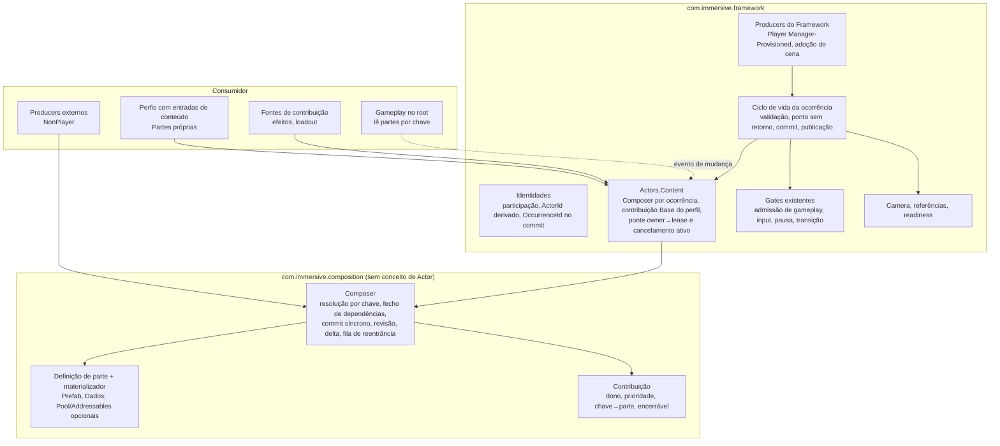
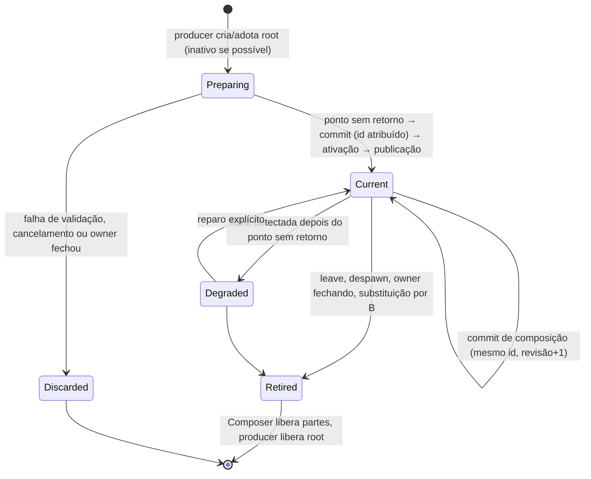
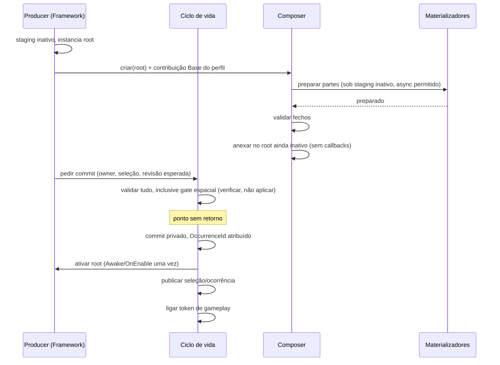
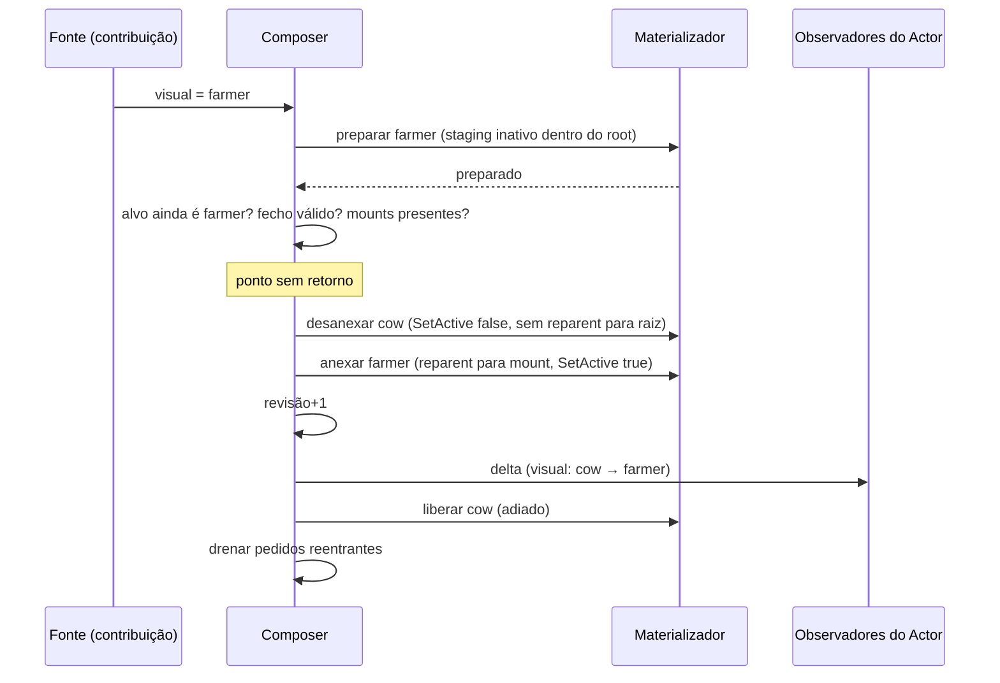

# Segunda auditoria arquitetural independente: composição dinâmica de Actors

| Item | Valor |
|---|---|
| Data | 2026-10-17 |
| Código avaliado | `com.immersive.framework` master remoto `f1a8414` (`1.2.0-preview.2`, commit de 2026-10-17 14:04 -0300). É o mesmo commit do parecer anterior. |
| Pacotes irmãos | pooling `8befe28` (0.2.3), audio `481f5e0` (0.2.4), foundation `86b5e17` (0.2.3), logging `fe19eff` (0.2.4), consumidor `planet-devourer` `1678112` |
| Documentos avaliados | `IF-ADR-050`, `IF-SPEC-050` (ambos "Proposed", 2026-10-17) e o parecer anterior `actor-composition-architecture-assessment-2026-10-17.md` |
| Cópia local do usuário | **Não foi lida.** A sessão roda na nuvem e não alcança a máquina do usuário. Tudo foi lido dos remotos acima. |
| Método | Leitura estática, somente leitura. Unity não foi executado, nenhum teste rodou, nada foi alterado em nenhum repositório. Afirmações sobre comportamento da Unity estão marcadas como **[Unity]** e vêm da documentação e do comportamento conhecido do engine, não de execução. |
| Postura | Revisor adversarial das três propostas: o parecer anterior (chamado aqui de **P-ANT**), a ADR/SPEC-050 (**P-050**) e o código atual (**P-ATUAL**). A recomendação final (**P-REC**) foi formada depois das refutações. |

Referências de código usam caminhos relativos ao repositório do Framework, com linha. Caminhos de outros repositórios levam o nome do repositório na frente.

---

## Sumário executivo

1. **O núcleo do problema não é composição; é a ordem dos efeitos dentro de uma operação síncrona.** O código atual já executa a substituição de Actor inteira num único call stack síncrono (`Runtime/PlayerParticipation/Runtime/PlayerActorPreparationRuntimeContext.cs:819-1306`). Mesmo assim ele publica a mudança de seleção antes de ativar B (`:1160`), ativa B com A ainda ativo (`:1197` antes de `:1270`) e, ao liberar, reativa o visual antigo por reparent (`AttachedPlayerActorMaterializationAdapter.cs:188-201`). Esses defeitos não vêm da falta de um contrato de autorização, nem da falta de Layers; vêm da sequência.
2. **"Mesmo frame" garante muito, mas não o que as duas propostas supõem.** Uma sequência síncrona no main thread não pode ser intercalada por input, física, render, corrotinas ou continuações `async` **[Unity]**. Ela é, porém, totalmente visível aos callbacks que ela mesma dispara (`Awake`, `OnEnable`, `OnDisable`, eventos C#), e exceções nesses callbacks são registradas pela Unity e não chegam a quem chamou `SetActive` **[Unity]**. Portanto: a falha de ativação de componentes é, em geral, **inobservável** pelo commit, e a "compensação por reanexação" do P-ANT e a "falha de ativação detectada pelo producer" do P-050 cobrem só falhas do próprio Framework.
3. **Conclusão de transação:** validar tudo o que pode falhar de forma detectável **antes** de qualquer efeito, cruzar um **ponto sem retorno**, aplicar os efeitos numa ordem fixa (commit lógico privado, desativar o antigo, ativar o novo, publicar por último) e tratar qualquer coisa depois disso como estado degradado, nunca como rollback. Isso elimina o contrato genérico de autorização operacional do P-050, o resultado de "handoff parcial", e a compensação por reanexação do P-ANT.
4. **O contrato de autorização operacional do P-050 já existe na forma especializada que basta.** O consumidor só move o Actor quando `PlayerGameplayInputReader.RuntimeGameplayAvailable` é verdadeiro (`planet-devourer/.../CharacterSelectionActorMovement.cs`), e esse leitor é ligado por token de admissão de gameplay (`Runtime/PlayerParticipation/Authoring/PlayerGameplayInputReader.cs:22-60`). Um contrato genérico só agrega valor se algum produto exigir A e B ativos simultaneamente em frames diferentes, o que não é requisito estabelecido.
5. **Shell genérico, Slots como assets, Layers com taxonomia fixa e CapabilityTable (do P-ANT) são complexidade prematura.** O root da ocorrência já é o Shell (`PlayerActorRuntimeHost`), e o prefab de root é por Local Player Host, não por perfil (`Runtime/PlayerParticipation/Authoring/LocalPlayerHostAuthoring.cs:44`). O mínimo necessário é: chave de conteúdo, definição de parte com materializador, um Composer por ocorrência, contribuições com dono e prioridade, e um evento de mudança com revisão.
6. **O "estado desejado com revisão única" do P-ANT tem um defeito real:** ele acopla latência e falha de chaves independentes (uma parte lenta ou inválida bloqueia todas as outras mudanças). O modelo que resiste aos cenários é híbrido: resolução por chave, commit por fecho de dependências, contador de revisão monotônico por ocorrência. A SPEC-050 já descrevia o agrupamento por fecho de dependências (§7.2); a crítica do P-ANT a esse ponto era, em grande parte, injusta.
7. **Direção de dependência.** A inversão de dependências torna a alternativa "pacote acima do Framework" tecnicamente possível, o que o P-ANT negou de forma imprecisa. Mesmo assim ela perde: ou o Framework mantém uma implementação padrão do visual (dois mecanismos), ou o pacote vira obrigatório de fato. Recomendo um **núcleo pequeno abaixo do Framework** (`com.immersive.composition`, sem conceito de Actor), dependência **obrigatória** do Framework, com a integração de Actor **dentro** do Framework. O `presentationPrefab` atual vira a contribuição base de uma chave `visual`.
8. **Identidades.** Existe uma identidade que nenhuma das propostas considerou: `PlayerOccurrenceId`, "identity for one exact joined Player lifetime" (`Runtime/PlayerParticipation/Contracts/PlayerOccurrenceId.cs:8`). Ela já é a identidade estável da participação. A proposta do P-ANT de tornar `ActorId` estável "durante a participação" criaria uma duplicata dela. E o `ActorOccurrenceId` de Player é cunhado de forma preguiçosa na resolução e recunhado sempre que o predicado de evidência falha (`Runtime/Actors/References/ActorOccurrenceReferenceRuntime.cs:421-451`), o que torna a identidade de encarnação instável sem troca física.
9. **Dez problemas novos** foram confirmados ou demonstrados no código (seção 12), entre eles o visual liberado que volta a ficar ativo, o rollback de ativação que deixa A sem evidência atual, o evento de seleção reentrante que faz a Camera reconciliar com estado intermediário, e o pooling que sempre ativa no `Rent`.
10. **Confiança.** Alta nas constatações de código e na ordem de efeitos recomendada. Média na direção de dependência (depende de haver um segundo consumidor não-Actor). Baixa onde o requisito não existe ainda: múltiplas fontes simultâneas, recursos assíncronos, pooling de Actors e dependências entre partes. As decisões críticas têm falsificadores explícitos na seção 15.

---

## 0. Método, escopo e o que não foi verificado

- O commit avaliado é o mesmo do parecer anterior, então qualquer divergência entre os dois relatórios é de análise, não de código.
- Li integralmente IF-ADR-050, IF-SPEC-050, o parecer anterior, o caminho de materialização e substituição do Player, a resolução de ocorrências (IF-ADR-049), a Camera de Session na parte de reconciliação, o pooling, a integração de áudio e os scripts de Player do consumidor.
- Não executei Unity. Os pontos marcados **[Unity]** que sustentam conclusões críticas estão listados na seção 15 como "exigem prova prática".
- Não há plano de implementação neste documento. Contratos são descritos por responsabilidade, sem assinaturas.

---

## 1. Achados confirmados, com referências ao código (resultado 1)

### 1.1 Afirmações das propostas, conferidas

| # | Afirmação | Fonte | Resultado | Evidência |
|---|---|---|---|---|
| V1 | Player é materializado sob staging inativo | P-050, P-ANT | Confirmado | `AttachedPlayerActorMaterializationAdapter.cs:98-102` (staging `SetActive(false)` antes do `Instantiate`), `:108` e `:127` (host e visual com `activeSelf=false`) |
| V2 | A substituição muda a seleção antes de ativar B e registra B depois | P-050 | Confirmado | `PlayerActorPreparationRuntimeContext.cs:1160` (seleção), `:1197` (ativação), `:1261` (registro), `:1270` (liberação de A) |
| V3 | A substituição libera gameplay de A antes da troca física | P-050, P-ANT | Confirmado | `ActivityPlayerActorLifecycleParticipant.PreparedActorReplacement.cs:40`, `:57` |
| V4 | Substituição só para Manager-Provisioned | P-ANT | Confirmado | `ActivityPlayerActorLifecycleParticipant.PreparedActorReplacement.cs:22-23` |
| V5 | `ActorId` de Player é gerado por materialização | P-ANT, P-050 | Confirmado, e contradiz a documentação do tipo | `AttachedPlayerActorMaterializationAdapter.cs:325-326` gera `player-actor:{...}:{sequence}`; `Runtime/Actors/ActorId.cs:8` documenta "Stable logical identity" |
| V6 | `ActorOccurrenceId` "já existe" | P-ANT | Confirmado, mas com semântica diferente da suposta | Existe (`Runtime/Actors/References/ActorOccurrence.cs:38`), é sequência local do host (`ActorOccurrenceReferenceRuntime.cs:533-538`), cunhada preguiçosamente na resolução de Player (`:444`) |
| V7 | `ActorOccurrenceId` é alocado na aceitação do candidato | P-050 (proposta) | Não é o comportamento atual; a própria ADR o trata como migração | `ActorOccurrenceReferenceRuntime.cs:421-451` |
| V8 | O gate de PlayerInput é especializado, não Actor-wide | P-050 | Confirmado | `Runtime/UnityInput/UnityPlayerInputGateAdapter.cs`; consumo real via `PlayerGameplayInputReader.RuntimeGameplayAvailable` (`PlayerGameplayInputReader.cs:57-61`) |
| V9 | O prefab de root é o mesmo para todos os perfis | P-ANT | Confirmado | `LocalPlayerHostAuthoring.cs:44` |
| V10 | Perfis do consumidor diferem só no visual | P-ANT | Confirmado | `planet-devourer/Assets/_Sample/PlayerSamples/CharacterSelection/Player/ActorProfile_Cow.asset`, `ActorProfile_Farmer.asset` |
| V11 | Pooling serve como provider de partes sem `Awake` | P-ANT | **Refutado como está** | `com.immersive.pooling/Runtime/Unity/Pools/GameObjectPool.cs:205-209` (criação instancia sob o pai do pool e só depois desativa), `:240` (`Rent` sempre faz `SetActive(true)`), `:113` (`OnTakenFromPool` no `Rent`) |
| V12 | O Framework não pode usar um pacote acima dele para o próprio Player | P-ANT | **Refutado como afirmação absoluta** | Há precedente de inversão: `Runtime/Audio/Immersive.Framework.Audio.asmdef` (assembly opcional por `versionDefines`) e `Runtime/Audio/FrameworkBgmDirectorInjectionRuntime.cs` (participante descoberto sob raízes de cena) |
| V13 | A Camera guarda o Subject resolvido e só reconcilia por eventos | P-ANT | Confirmado | `Runtime/Camera/Assignments/SessionCameraAssignmentRuntime.cs:2235-2236` (inscrições), `:2336-2367` (handlers), `:2439-2471` (Subject a partir do Transform de observação) |
| V14 | Token de cancelamento do RuntimeContent é passivo | P-050, P-ANT | Confirmado | `Runtime/RuntimeContent/RuntimeScopeCancellationToken.cs:56-60` |
| V15 | Adapter de materialização é síncrono | P-ANT | Confirmado | `Runtime/RuntimeContent/IRuntimeMaterializationAdapter.cs:18` |

### 1.2 Achados novos (detalhe na seção 12)

| # | Achado | Classificação | Evidência |
|---|---|---|---|
| N1 | O visual liberado volta a ficar ativo na raiz da cena até o `Destroy` | Problema confirmado no código (efeito depende de **[Unity]**) | `AttachedPlayerActorMaterializationAdapter.cs:188` desativa o host; `:198-201` faz `SetParent(null, true)` no visual cujo `activeSelf` foi posto em `true` em `PlayerActorMaterializationHandle.cs:126` |
| N2 | O evento de mudança de seleção é publicado no meio da substituição e a Camera reconcilia com estado intermediário | Problema confirmado no código | `PlayerActorPreparationRuntimeContext.cs:1160` → `PlayerParticipationRuntimeContext.cs:816-823` (`SelectionRevision++` e `Changed`) → `SessionCameraAssignmentRuntime.cs:2336-2352` → `ReconcileSlot` `:2408-2418`; a correção só chega em `PlayerActorPreparationRuntimeHostModule.cs:763` |
| N3 | Rollback de falha de ativação deixa A sem evidência de atual | Problema confirmado no código (caminho de borda) | `PlayerActorPreparationRuntimeContext.cs:1209` faz nova `TryReplaceActorSelection`, que incrementa `SelectionRevision` (`PlayerParticipationRuntimeContext.cs:816`); o registro de A não é atualizado, e os predicados comparam a revisão (`PlayerActorPreparationRuntimeContext.PhysicalOccurrence.cs:33`, `...CurrentActorEvidence.cs:219`) |
| N4 | `ActorOccurrenceId` de Player é derivado de predicado, não de ciclo de vida | Problema confirmado no código | `ActorOccurrenceReferenceRuntime.cs:424-450`; o predicado exige `activeInHierarchy` (`...PhysicalOccurrence.cs:49`) |
| N5 | `PlayerOccurrenceId` é a identidade estável de participação e está ausente das duas propostas | Contradição arquitetural demonstrada (no P-ANT) | `Runtime/PlayerParticipation/Contracts/PlayerOccurrenceId.cs:8`; usada pela Camera (`SessionCameraAssignmentRuntime.cs:2390-2414`) |
| N6 | B fica ativo enquanto A ainda está ativo | Problema confirmado no código (efeito plausível) | `PlayerActorPreparationRuntimeContext.cs:1197` ativa B; A só é desativado dentro da liberação em `:1268-1272` |
| N7 | Exceções em callbacks não chegam ao commit | Comportamento **[Unity]**; consequência confirmada no código | `PlayerActorMaterializationHandle.cs:126-134` retorna sucesso sem inspecionar componentes |
| N8 | Reanexar partes não restaura estado | Comportamento **[Unity]** | `Animator` reinicia ao reativar salvo `keepAnimatorStateOnDisable`; `OnEnable` roda de novo |
| N9 | Já existem duas fontes de visual: prefab do perfil e filho de cena | Problema confirmado no código | `PlayerActorPreparationRuntimeContext.ScenePlayerActorAdoption.cs:148`, `:218-222`; o perfil só é comparado por referência em `:130` |
| N10 | `Rent` do pooling dispara `OnTakenFromPool` durante a preparação | Problema confirmado no código | `GameObjectPool.cs:111-113`, `:238-242` |

---

## 2. Investigação A: fronteira e direção de dependência

### 2.1 As quatro alternativas

```text
A. Especializado acima                B. Genérico abaixo (P-ANT)
   Consumidor                            Consumidor
     └─ actor-composition                  └─ framework
          └─ framework                          └─ composition (tudo: Slot, Layer,
   Core expõe seams; pacote implementa.             Composer, CapabilityTable, providers)

C. Núcleo genérico + integração       D. Núcleo mínimo abaixo, integração dentro (P-REC)
   especializada separada                Consumidor
   Consumidor                              └─ framework ── assembly Actors.Content
     ├─ actor-composition ─┐                    └─ composition (só mecanismo)
     │    ├─ framework     │             Dependência obrigatória. Nenhum seam de
     │    └─ composition ◄─┘             descoberta. Um único caminho de conteúdo.
     └─ (framework não depende de nada)
   Variante C': integração dentro do Framework, opcional por versionDefines
   (precedente: Immersive.Framework.Audio).
```

### 2.2 Os oito critérios, alternativa por alternativa

**A. Pacote especializado acima do Framework (direção do P-050)**

1. Dependências: `actor-composition → framework`. Core publica contratos; pacote implementa.
2. Composição inicial do Player: o producer do Player chama o participante de preparação descoberto no host (SPEC §6.1), que prepara contribuições contra o contexto do candidato; Core ativa e comita. Funciona, desde que o Core saiba consultar o host (seam de registro) e saiba se a composição é obrigatória (sinal no Core, SPEC §6.1).
3. Destino do `presentationPrefab`/`VisualContentMount`: há só duas saídas coerentes. (a) Continua no Core como implementação padrão do seam. Isso é uma segunda implementação de composição de conteúdo, embora trivial. (b) Sai do Core e vai para o pacote. Então quem não instala o pacote perde o visual, e o pacote vira obrigatório de fato.
4. Evitar duas implementações: só por (b), que contradiz a premissa do próprio desenho ("Core remains useful without it", SPEC §7.1), ou aceitando (a) como Strategy com uma implementação padrão mínima. Com (a), o comportamento da substituição pode divergir entre os dois providers.
5. Contratos públicos necessários: registro de participante por host, sinal de exigência, contexto de candidato, participante de preparação, commit condicional, observador de ciclo de vida, coordenação de limpeza (SPEC §6, sete linhas) e, se mantido, autorização operacional. **Seis a oito contratos públicos novos no Core** só para a integração.
6. Custo real: alto no Core (os seams precisam ser expressivos o bastante para preparação assíncrona, cancelamento e substituição) e no authoring: o `ActorProfile` do Core não pode referenciar tipos do pacote, então a receita de composição vive num segundo asset que aponta para o perfil. Dois assets por Actor para manter coerentes.
7. Projeto sem composição: bom. Nada instalado, nada registrado.
8. Ciclos e duplicação: sem ciclo estrutural (SPEC §11.1 está correta). Duplicação de responsabilidade: provável no caso (a); requisito "obrigatório" modelado no Core para um recurso que o Core não conhece.

Vantagem real que o P-ANT não reconheceu: o pacote pode usar diretamente os tipos de Actor, ocorrência e owner, sem uma camada genérica traduzindo. Se nunca houver consumidor não-Actor, essa vantagem pesa.

**B. Pacote genérico abaixo, com o modelo completo do P-ANT**

1. Dependências: `framework → composition`.
2. Composição inicial: o producer cria o Composer do root, aplica a receita, ativa. Chamada direta, sem descoberta.
3. `presentationPrefab` migra para uma parte no slot Visual. Um único mecanismo.
4. Duas implementações: evitadas por construção.
5. Contratos: Slot, Part, Layer, Composer, Host, handlers, CapabilityTable, providers (Instantiate, Pool, Addressables), mais `ActorDefinition`, `ActorShell` e `NonPlayerSpawner` no Framework. **Mais de dez tipos públicos** no pacote e vários no Framework.
6. Custo: grande, e grande parte dele sem requisito estabelecido (seção 3).
7. Projeto sem composição: paga a dependência e a superfície inteira.
8. Ciclos: nenhum. Risco: um pacote "genérico" desenhado a partir de um único consumidor (Actor), cuja generalidade só seria provada por um segundo caso que não existe.

**C. Núcleo genérico + integração especializada separada**

1. Dependências: `actor-composition → {framework, composition}`; o Framework não depende de nenhum dos dois. Variante C': integração como assembly opcional dentro do Framework, compilada por `versionDefines` quando o núcleo está presente (exatamente como `Runtime/Audio/Immersive.Framework.Audio.asmdef`).
2. Composição inicial: igual a A, porque o Framework continua sem chamar o núcleo diretamente.
3. `presentationPrefab`: mesmo dilema de A. Em C' o Framework precisa de um caminho de visual para quando o núcleo está ausente.
4. Duas implementações: inevitáveis enquanto a integração for opcional.
5. Contratos: os de A mais a API do núcleo.
6. Custo: o maior das quatro (três unidades versionadas e seams).
7. Sem composição: bom.
8. Ciclos: nenhum. Duplicação: a mesma de A.

C só ganha vantagem real se a integração for **obrigatória**. Nesse caso ela vira D.

**D. Núcleo mínimo abaixo, dependência obrigatória, integração de Actor dentro do Framework (recomendada)**

1. Dependências: `framework → composition`; o núcleo depende no máximo de foundation/logging e não contém Actor, Session, Route, Activity, Player nem `RuntimeContentOwner`.
2. Composição inicial do Player:
   ```text
   producer cria root sob staging inativo
     → integração cria Composer(root) e a contribuição Base a partir do ActorProfile
     → Composer.Prepare (instancia partes sob staging inativo, assíncrono se preciso)
     → Composer.Commit no root ainda inativo  (nenhum callback roda: o root está inativo)
     → Framework valida tudo → ponto sem retorno → commit da ocorrência → ativa root → publica
   ```
   O ponto crítico é que a composição **inicial** é aplicada a um root inativo. Todos os `Awake`/`OnEnable` acontecem uma única vez, na ativação do root, exatamente como hoje.
3. `presentationPrefab` vira a entrada `visual → PrefabPart(prefab)` da contribuição Base; `VisualContentMount` vira o mount da chave `visual`. Migração automática possível.
4. Uma implementação: o caminho atual de visual deixa de existir como código separado.
5. Contratos públicos do núcleo: chave de conteúdo, definição de parte, materializador de parte, Composer, handle de contribuição, resultado/delta de composição (seis). Contratos públicos novos no Framework: entradas de conteúdo no perfil, acesso ao conteúdo de uma ocorrência (adicionar contribuição com dono, observar mudança). Nenhum seam de descoberta, nenhum sinal de exigência.
6. Custo: uma dependência obrigatória a mais e a ponte de owner/cancelamento no Framework. Menor que A em contratos; menor que B em tipos.
7. Sem composição: o Composer com uma chave (ou nenhuma, se o perfil não tem visual) é o custo inteiro. A criação pode ser preguiçosa.
8. Ciclos: nenhum. A regra de fronteira (o núcleo não conhece Actor) é verificável pelas referências de asmdef.

### 2.3 Cenários concretos que separam as alternativas

| Cenário | A | B | C/C' | D |
|---|---|---|---|---|
| Projeto novo só quer "perfil com visual" | Instala só o Framework; usa o caminho padrão | Paga a superfície inteira do pacote | Igual a A | Usa a contribuição Base; nada a aprender |
| Mesmo projeto quer "trocar visual sem recriar" | Instala o pacote, migra para o asset de receita do pacote, troca de provider | Já disponível | Instala núcleo + integração | Já disponível pela API de conteúdo |
| Arma com skins (objeto não-Actor) | Não atende (pacote é de Actor) | Atende | Atende pelo núcleo | Atende pelo núcleo |
| Mudar a semântica de substituição | Exige mudar seams do Core e o pacote em versões coordenadas | Mudança interna ao Framework | Igual a A | Mudança interna ao Framework |
| Pacote ausente mas perfil exige composição | Precisa do sinal de exigência no Core | Impossível | Precisa do sinal | Impossível |

### 2.4 Veredito da Investigação A

- O P-ANT estava certo na direção e errado no motivo. Inversão de dependências permite que o Framework use uma implementação acima dele (há precedente no próprio repositório). O que derruba A não é impossibilidade técnica; é que a inversão obriga a escolher entre dois mecanismos de conteúdo e um pacote obrigatório disfarçado.
- B está certo na direção e errado no tamanho.
- D é a forma de B que sobrevive à seção 3.
- **Falsificador:** se, no horizonte de evolução, nenhum objeto não-Actor precisar de composição e a equipe preferir que o pacote use tipos de Actor diretamente, a melhor opção passa a ser **composição dentro do Framework** (assembly interno, sem pacote). A deveria ser reavaliada só se o Framework precisar ficar sem conteúdo de visual nenhum por padrão.

---

## 3. Investigação B: modelo de composição

### 3.1 Triagem dos conceitos

| Conceito (P-ANT) | Fundamental? | Por quê | Destino em P-REC |
|---|---|---|---|
| Actor Shell (tipo genérico) | **Não** | O root da ocorrência já cumpre o papel (`PlayerActorRuntimeHost`; para NonPlayer, o root com `ActorDeclaration`). Um tipo novo só renomeia. O que importa é a disciplina "estado estável vive no root" e a validação dela. | Eliminado. Fica a regra de validação. |
| Slot como asset (cardinalidade, tipos aceitos, componentes proibidos) | **Parcial** | Sem uma chave não há como dizer "substitua o visual" em vez de "adicione outro". Cardinalidade múltipla e tipos aceitos não têm requisito. Componentes proibidos já existem como validação do visual (`AttachedPlayerActorMaterializationAdapter.cs:310-315`). | Fica uma **chave de conteúdo** (identificador tipado) com mount associado. Cardinalidade 1 por chave. Regras de proibição ficam no materializador. |
| Part (definição + handler) | **Sim** | É o único jeito de estender tipos de conteúdo sem tocar no Framework. | Mantido: definição de parte + materializador por tipo. |
| Layers com taxonomia e prioridades fixas (Base 0 … Temporary 400) | **Não como taxonomia** | Nenhum consumidor tem mais de uma fonte hoje. A taxonomia fixa codifica decisões de produto no mecanismo. | Fica a **contribuição**: dono, prioridade numérica, mapa chave→parte, encerrável. O Framework predefine só "Base" (perfil). |
| Composer | **Sim** | É o escritor único que serializa commits sobre um root. | Mantido, um por ocorrência. |
| Estado desejado | **Sim, por chave** | Pedidos mudam o alvo da chave; o Composer converge. Uma fila de comandos é pior. | Mantido por chave, não global (3.2). |
| CapabilityTable | **Não** | Uma capacidade é um componente na instância da parte. Consultar a parte atual da chave e ouvir a mudança basta. Um registro tipado só seria necessário para capacidades sem GameObject, e essas são as partes de dados, que já são consultáveis pela chave. | Eliminado. Fica "consultar parte atual por chave" + evento de mudança. |
| Mounts | **Sim** | Já existem (`VisualContentMount`). | Mantido, associado à chave. |
| Sockets (pontos publicados por partes) | **Não agora** | Só servem para parte-sobre-parte (arma na mão). Sem requisito. | Ponto de extensão: um mount pode ser resolvido a partir de outra chave, o que cria dependência declarada. |
| Providers e leases de asset ref-counted | **Não no contrato geral** | Só Addressables precisa de ref-count, e isso é detalhe interno do materializador de Addressables. | Ficam dentro do materializador. O núcleo não tem conceito de lease de asset. |
| Lease de **contribuição** por dono | **Sim, se houver múltiplas fontes** | Necessário para T06 (contribuição temporária termina com o Actor vivo). | Mantido como handle encerrável; a ponte para owners de Session/Route/Activity fica no Framework. |
| `IPartLifecycle` (OnAttached/OnDetached) | **Opcional** | Útil para componentes de parte que se inscrevem em serviços. Não é necessário para partes que só renderizam. | Opcional. |
| `IPartStateTransfer` / `IShellStateTransfer` | **Não agora** | Continuidade de estado do Animator não tem requisito no consumidor (nenhum Animator nas amostras de Player). | Ponto de extensão no materializador. |

**Conjunto mínimo:** chave de conteúdo, definição de parte, materializador de parte, Composer, contribuição com dono e prioridade, resultado com delta e revisão. Seis conceitos. Nada aqui impede adicionar Sockets, transferência de estado ou providers assíncronos depois, porque todos entram como implementações de materializador ou como dependência entre chaves.

### 3.2 Modelos de mudança

| Critério | Modelo 1: contribuições independentes com revisão própria | Modelo 2: estado desejado global com revisão única (P-ANT) | Modelo 3: resolução por chave, commit por fecho de dependências (P-REC) |
|---|---|---|---|
| Troca de uma parte isolada | Simples | Simples, mas espera qualquer preparação em curso em outra chave | Simples; não espera chaves não relacionadas |
| Troca de partes dependentes (T04) | Exige agrupamento explícito pelo chamador | Natural | Natural, se a dependência for declarada |
| Fontes simultâneas (T05) | Precisa de regra fora do modelo | Natural pela resolução | Natural pela resolução por chave |
| Falha de uma parte | Isolada | **Bloqueia o alvo inteiro**: o estado desejado fica insatisfazível para todas as chaves | Isolada ao fecho daquela chave |
| Latência | Isolada | **Bloqueio de cabeça de fila**: parte lenta segura as rápidas; uma fonte que muda com frequência pode impedir uma preparação lenta de terminar (replanejamento contínuo) | Isolada ao fecho |
| Combinações intermediárias não testadas | Possíveis | Impossíveis | Possíveis só entre chaves declaradas independentes, o que é exatamente o que "independente" significa |
| Concorrência otimista | Por contribuição | Por Actor | Contador monotônico por ocorrência; versão própria no handle de contribuição se o escritor precisar |
| Estados | Muitos | Poucos | Poucos por fecho |

O Modelo 2 falha no cenário "VFX temporário a cada segundo + troca de visual por Addressables que leva três segundos": cada mudança do VFX replaneja o alvo e a troca de visual pode nunca comitar, ou comita junto com um VFX que já expirou. O Modelo 3 comita os dois de forma independente. É também o que a SPEC-050 descreve em §7.2 ("a grouped operation contains only the affected dependency closure"), com a diferença de que a SPEC mantém uma revisão por contribuição, e eu considero um contador por ocorrência suficiente para invalidação de cache. Essa diferença é **preferência de desenho**, não defeito de nenhum dos dois.

### 3.3 Temas obrigatórios

| Tema | Tratamento no Modelo 3 | Contrato necessário |
|---|---|---|
| Troca de parte isolada | Contribuição muda a entrada da chave; Composer prepara só ela; commit do fecho (só ela) | Nenhum além do mínimo |
| Partes dependentes | A definição de parte declara as chaves das quais depende (por exemplo, `weapon` depende de `visual` porque usa um mount que vem do visual). Mudança em `visual` puxa `weapon` para o mesmo fecho; o commit desanexa na ordem inversa e anexa na ordem de dependência | Dependência declarada na definição de parte; ciclos rejeitados na validação |
| Fontes simultâneas, precedência e conflito | Por chave vence a maior prioridade; **mesma prioridade de donos diferentes para a mesma chave é rejeitada no pedido**, não resolvida por último-escritor | Prioridade numérica; regra de conflito |
| Configuração sem GameObject | Parte de dados: o materializador não instancia nada; "anexar" é tornar o valor atual da chave. Componentes do root consultam a chave e reagem à mudança | Nenhum contrato extra; `IConfigurable<T>` do P-ANT vira açúcar opcional |
| Animação, visual e comportamento | Comportamento (movimento, física, input) no root; visual na chave `visual`; se o Animator vem no visual, quem o dirige consulta a parte atual da chave `visual` no evento de mudança | Evento de mudança com delta |
| Recursos compartilhados | Instâncias são do Composer; assets são do materializador (ref-count interno se Addressables). Dois Actors com a mesma parte compartilham o asset, não a instância | Nenhum no núcleo |
| Atualizações concorrentes e assíncronas | Um commit por vez por Composer. Preparação concorrente por fecho; resultado tardio comparado com o alvo atual da chave no momento do commit; se o alvo mudou, o resultado é descartado e liberado por quem o preparou | Token de cancelamento ativo por ocorrência |
| Continuidade de estado | O root não é trocado, então movimento e gameplay continuam. Estado que vive dentro da parte (pose do Animator) só continua com um transferidor do materializador | Ponto de extensão |
| Ownership da composição vs dos recursos | Composer é dono da **aplicação** (quais instâncias estão anexadas); o materializador é dono da **obtenção e liberação** (Instantiate/Destroy, Rent/Return, Load/Release); o dono da contribuição é dono só da **intenção**; o producer é dono do **root** | Separação explícita, sem lease geral |

---

## 4. Investigação C: transações e garantias Unity

### 4.1 O que a Unity garante e o que não garante

| # | Fato **[Unity]** | Consequência para o desenho |
|---|---|---|
| U1 | `Instantiate` sob pai inativo adia `Awake`/`OnEnable` até o objeto ficar ativo na hierarquia | Preparação sob staging inativo não executa código de usuário. É a base do V1. |
| U2 | `SetActive(true)` executa `Awake` (primeira vez) e `OnEnable` de cada componente habilitado, dentro da chamada; a ordem entre GameObjects diferentes não é útil como garantia | Tudo o que o código de usuário faz nesses callbacks acontece **dentro** do commit e vê o estado intermediário dele |
| U3 | `Start` roda mais tarde, antes do primeiro `Update` do script, nunca dentro do `SetActive` | Nenhum commit pode observar falha de `Start` |
| U4 | `SetActive(false)` executa `OnDisable` dentro da chamada | Teardown de A acontece no meio do commit |
| U5 | Reparent que muda `activeInHierarchy` dispara `OnEnable`/`OnDisable` (e `Awake` na primeira ativação) | Reparent é um efeito, não uma operação neutra (N1) |
| U6 | Exceções em mensagens da Unity (`Awake`, `OnEnable`, `OnDisable`) são registradas e não propagadas a quem chamou `SetActive`/`Instantiate`; os demais componentes continuam | Falha de componente é, em geral, **inobservável** pelo commit (N7) |
| U7 | `Object.Destroy` é adiado para o fim do loop de Update corrente, antes do render; até lá o objeto existe | "Liberado" e "destruído" diferem por até um frame; ninguém precisa de confirmação disso além de testes |
| U8 | Simulação de física só ocorre no passo de física; nenhum contato é gerado dentro de uma chamada síncrona. Consultas (`Raycast`, `Overlap`) feitas por callbacks dependem da sincronização de transforms | A e B nunca colidem dentro do commit; consultas feitas em `OnEnable` podem ver os dois |
| U9 | Eventos do Input System são processados no update do Input System (por padrão antes do `Update`), não dentro de chamadas de usuário | Nenhuma ação de input é entregue no meio do commit |
| U10 | Corrotinas, `Awaitable` e continuações `async` no main thread retomam em pontos do player loop | Nenhum trabalho assíncrono intercala o commit síncrono |
| U11 | `Animator` reinicia o estado ao desativar e reativar, salvo `keepAnimatorStateOnDisable`; componentes com "play on awake" (áudio, partículas) podem disparar de novo ao reativar | Reanexar não é restaurar (N8) |

**O que isso prova:** uma sequência síncrona tem **atomicidade de fronteira de frame**. Ela é indivisível para input, física, render, corrotinas, continuações assíncronas e o `Update` dos outros objetos. Ela **não** é atômica para os callbacks e eventos que ela própria dispara, não detecta falhas desses callbacks, e não oferece rollback. As duas propostas anteriores tratavam "mesmo frame" como uma coisa só; são duas.

### 4.2 Sequências comparadas para a substituição A→B

```text
S1 (P-ATUAL, PlayerActorPreparationRuntimeContext.cs:1100-1306)
  materializa B inativo ─► muda seleção + publica Changed ─► ativa B ─► troca registro ─► libera A
                           │ (Camera reconcilia sem Actor)   │ (A e B ativos)               │ (visual de A reativa)
                           └── N2                            └── N6                         └── N1
  depois, fora do contexto: InvalidateCurrentActorOccurrence (HostModule.cs:763) ─► reprojeção de gameplay

S2 (P-050, SPEC §4.1)
  B preparado ─► B ativado com gates fechados (pode atravessar frames) ─► suspende A ─► commit condicional
     ─► publica ─► abre gates de B ─► retira A
  Problema: se ativar e comitar ficam em frames diferentes, A e B ficam ativos juntos por frames,
  e só componentes cooperativos respeitam o gate. Daí a necessidade do contrato de autorização.

S3 (P-ANT, §4.10)
  B composto e inativo ─► [síncrono] revalida ─► desativa A ─► transfere ─► commit ─► ativa B ─► publica ─► move token
  Correto na ordem. Errado em dois pontos: supõe que exceções no attach são detectáveis e compensáveis
  por reanexação, e não trata reentrância (callbacks de B pedindo nova substituição dentro do commit).

S4 (P-REC)
  Fase de preparação (pode ser assíncrona): B materializado e composto sob staging inativo; nada publicado.
  Fase de validação (síncrona, sem efeitos): owner, A atual esperado, revisão de seleção, B íntegro,
     gate espacial verificado (não aplicado), mounts presentes. Qualquer falha aqui: descarta B; A intacto.
  ══════════ ponto sem retorno ══════════
  1. commit lógico privado: registro passa a B; seleção passa a B SEM publicar evento
  2. A.SetActive(false)          → OnDisable de A (A já não é o atual)
  3. aplica pose; B.SetActive(true) → Awake/OnEnable de B (B já é o atual nas consultas)
  4. verificação pós-ativação opcional (sondas de prontidão) → só pode degradar, nunca reverter
  5. publica: evento de seleção, invalidação de ocorrência, refresh de referências
  6. move o token de gameplay de A para B (reprojeção)
  7. agenda a liberação de A (detach sem reparent para raiz ativa; Destroy adiado)
  8. executa pedidos reentrantes enfileirados durante 1–7
```

| Propriedade | S1 | S2 | S3 | S4 |
|---|---|---|---|---|
| Observadores veem estado intermediário via eventos | Sim (N2) | Não | Não | Não |
| Callbacks de B veem A ativo | Sim (N6) | Sim | Não | Não |
| Callbacks de B veem B como atual | Não | Não | Depende da ordem | Sim |
| Frames com A e B ativos | Não | Possível | Não | Não |
| Precisa de autorização operacional genérica | Não tem; tem os gates específicos | Sim | Não | Não |
| Falha detectável depois de efeitos | Ativação (gate espacial) depois de mudar seleção | Ativação e handoff | Exceção no attach (quase nunca detectável) | Nenhuma: tudo detectável é validado antes |
| Rollback | Tenta, com N3 | Não depois do commit; "handoff parcial" antes | Reanexação | Não existe; degradação explícita |
| Reentrância | Não tratada | "Rejeitar ou adiar" | Não tratada | Adiada para o passo 8 |

### 4.3 Respostas às quatro perguntas

1. **Os gates especializados existentes bastam?** Para os requisitos estabelecidos, sim. Em S4 não há frame com dois Actors ativos, então o que resta proteger é input (já gated pelo token do leitor), gameplay (admissão), pausa e transição, que já têm gates próprios. Evidência de uso: o consumidor só move o Actor quando `RuntimeGameplayAvailable` é verdadeiro.
2. **Um contrato genérico de autorização operacional agrega valor?** Só num cenário que não é requisito hoje: B ativo e visível antes do commit por mais de um frame (crossfade de personagem, aquecimento de física, dissolve com os dois presentes). Fora disso, ele custa um conceito transversal que a própria SPEC admite não poder impor (§3.2, F07).
3. **É possível obter as garantias sem ele?** Sim, as garantias que a Unity permite: nenhum frame com dois Actors atuais; nenhum evento publicado com estado intermediário; nenhuma ação de input ou física entregue no meio. Não é possível garantir que código de usuário em `OnEnable` não faça efeitos; nenhuma proposta consegue isso, e S4 não promete.
4. **Existe solução mais simples e consistente?** S4: validar antes, ponto sem retorno, ordem fixa, publicar por último, reentrância adiada, degradação em vez de rollback.

### 4.4 Compensação: reversão estrutural vs reversão de efeitos

| Operação | Reversão estrutural possível? | Reversão de efeitos possível? |
|---|---|---|
| Instanciar sob staging inativo | Sim (Destroy) | Não há efeitos de usuário a reverter (U1) |
| Reparent de parte para mount inativo | Sim | Não há efeitos |
| Ativar parte/root | Sim (desativar) | **Não.** `Awake` não roda de novo; `OnEnable` já rodou; registros feitos podem ter disparado reações em terceiros |
| Desativar parte antiga e reativá-la | Sim | **Não.** `OnDisable`+`OnEnable` executam ciclo completo; Animator reinicia (U11); partículas e áudio podem disparar |
| Mudar seleção com publicação | Sim (nova mudança) | **Não.** Observadores já reagiram (N2) e a revisão avançou (N3) |

A afirmação do P-ANT de que "reanexar partes antigas constitui compensação barata" é verdadeira para a estrutura e falsa para os efeitos. A compensação segura só existe **antes** de qualquer ativação; por isso S4 move toda falha detectável para antes do ponto sem retorno e não oferece reanexação automática.

### 4.5 Demais tópicos da Investigação C

| Tópico | Conclusão |
|---|---|
| Callbacks reentrantes | Inevitáveis (U2, U4). Regra: o Composer e o ciclo de vida mantêm um estado "comitando"; pedidos recebidos nesse estado vão para uma fila drenada no fim (S4 passo 8). Rejeitar silenciosamente perde intenção; executar dentro corrompe a ordem. |
| Eventos e registros externos | Só publicar depois de todos os efeitos físicos (S4 passo 5). Registros feitos por componentes em `OnEnable` são do componente; o Framework não os desfaz. |
| Input e física | Protegidos pela fronteira de frame (U8, U9). Consultas físicas em `OnEnable` são a exceção residual. |
| Falha durante ativação | Inobservável por exceção (U6). Para quem precisa, sondas de prontidão após ativação, consultadas no passo 4, que só podem degradar. |
| Liberação adiada | Detach sem reparent para raiz ativa (corrige N1); Destroy ou devolução ao pool depois do commit; o resultado é "liberação pedida", e confirmação física é diagnóstico, não contrato. |
| Recursos assíncronos | Só na preparação, com cancelamento ativo ligado ao fechamento da ocorrência e ao owner. O commit nunca espera. |

---

## 5. Identidades e referências

### 5.1 Inventário real (não o suposto)

| Identidade | Onde | Semântica hoje | Problema |
|---|---|---|---|
| `ActorProfileId` | `Runtime/Actors/ActorProfile.cs:22` | Identidade de authoring | Nenhum |
| `ActorId` | `Runtime/Actors/ActorId.cs` | Documentado como lógico estável (`:8`); para Player é por materialização (`AttachedPlayerActorMaterializationAdapter.cs:326`) | Contradição entre tipo e uso |
| `PlayerOccurrenceId` | `Runtime/PlayerParticipation/Contracts/PlayerOccurrenceId.cs` | Uma participação Joined exata | **Ignorada pelas propostas** |
| `ActorOccurrenceId` | `Runtime/Actors/References/ActorOccurrence.cs:38` | Sequência local do host; Player: cunhada na resolução; NonPlayer: na publicação (`ActorOccurrenceReferenceRuntime.cs:469`) | Instável para Player (N4) |
| `PlayerActorPreparationToken` | `PlayerActorPreparationRuntimeContext` | Correlação de preparação | Funciona como identidade de encarnação de fato (`ActorOccurrenceReferenceRuntime.cs:437`) |
| `PlayerActorMaterializationOperationId` | `AttachedPlayerActorMaterializationAdapter.cs:64` | Operação de materialização | Já é a "identidade de candidato" que a ADR propõe criar |
| `RuntimeContentId` | `AttachedPlayerActorMaterializationAdapter.cs:327` | Registro de conteúdo | Nenhum |
| `CameraSubjectId` | `SessionCameraAssignmentRuntime.cs:2469` | Derivado do token de preparação | Muda a cada substituição; correto se a observação está no root |

Sete identidades já existem em volta de um Player Actor. As propostas acrescentam candidato, operação, composição e revisão. Antes de criar qualquer uma, é preciso dizer qual das existentes ela substitui.

### 5.2 O que precisa ser estável, e sob quais condições

| Identidade | Deve permanecer estável quando… | Deve mudar quando… | Proposta |
|---|---|---|---|
| Participação (`PlayerOccurrenceId`) | Troca de perfil, recomposição, substituição de root | Leave/rejoin | Mantida. É a referência de gameplay para "este jogador". |
| `ActorId` de Player | Recomposição e substituição de root dentro da mesma participação | Nova participação | **Derivar** de `PlayerOccurrenceId` (por exemplo `player-actor:{participação}`), documentado como derivação. Não é uma identidade nova; é o fim da contradição V5. O P-ANT chegava ao mesmo comportamento, mas como "identidade nova estável", o que duplicaria `PlayerOccurrenceId`. |
| `ActorId` de NonPlayer | Sempre que o autor declarar | Conforme o domínio declarado | Sem mudança: identidade declarada. |
| `ActorOccurrenceId` | Recomposição, desativação temporária, pausa | Novo root, ou reuso de root por pooling para outro Actor | **Atribuir no commit da ocorrência e manter enquanto comitada**, independente de predicados transitórios. Corrige N4. |
| Identidade de candidato | Não precisa existir como conceito público | — | Usar o id de operação que já existe. Refuta a necessidade de um conceito novo do P-050. |
| Revisão de composição | — | A cada commit de composição | Contador monotônico por ocorrência, público, para invalidar caches. |
| Seleção de Player (`SelectionRevision`) | — | Cada mudança de seleção | Sem mudança; mas não deve ser publicada antes do commit (S4). |

### 5.3 Casos específicos

| Caso | Comportamento com P-REC |
|---|---|
| Recomposição sem substituição de ocorrência | Mesmo root, mesmo `ActorOccurrenceId`, mesmo `ActorId`, revisão +1. Exige que a implementação não crie novo token de preparação, porque hoje o registro de resolução é chaveado pelo token (`ActorOccurrenceReferenceRuntime.cs:437`). |
| Substituição completa do root | Novo `ActorOccurrenceId` para B no passo 1 de S4; mesmo `ActorId` e mesma participação; referências exatas a A ficam `Stale`; referências por Slot ou `ActorId` seguem B. |
| Dois roots na mesma transição | B não tem `ActorOccurrenceId` nem é resolvível antes do ponto sem retorno; depois dele, A deixa de ser resolvível na mesma chamada. Nunca há dois resolvíveis. |
| Pooling e reuso físico | Reuso do mesmo GameObject para outro Actor = nova ocorrência, novo id. A chave de registro não pode ser só a referência do root. |
| NonPlayer externo | O producer é dono do root e do Composer; publica como hoje; o id nasce na publicação. |
| Scene-Provided já ativo | Id atribuído no commit da adoção. Partes já presentes na cena são registradas como **adotadas** (seção 6, T11). |
| Referências cacheadas de Camera, Animator | Identidade não resolve; o que resolve é a regra "observação da Camera no root" (validação) e o evento de mudança com revisão para quem guarda componentes de parte. |

---

## 6. Cenários obrigatórios T01–T16

Legenda: ✓ funciona com o que a arquitetura define; ◐ funciona com contrato adicional nomeado; ✗ falha ou não define.

| Cenário | P-ATUAL | P-050 | P-ANT | P-REC |
|---|---|---|---|---|
| T01 Actor sem composição especializada | ✓ | ✓ | ✓ (paga a superfície) | ✓ |
| T02 Visual e configuração de comportamento externos | ◐ visual sim, comportamento não (L2 do parecer anterior) | ✗ modelo de contribuição indefinido | ✓ | ✓ |
| T03 Troca de visual preservando movimento e gameplay | ✗ recria o Actor | ◐ "content-only update" sem mecanismo | ✓ | ✓ |
| T04 Duas partes dependentes | ✗ | ◐ fecho de dependências citado, sem modelo de dependência | ✓ via sockets | ✓ via dependência declarada |
| T05 Duas fontes, mesma capacidade | ✗ | ✗ precedência indefinida | ✓ por Layer | ✓ por prioridade, conflito rejeitado |
| T06 Contribuição temporária termina | ✗ | ◐ | ✓ | ✓ |
| T07 Preparação assíncrona cancelada por encerramento | ✗ não há async | ◐ cooperativa, token passivo | ✓ | ✓ |
| T08 Falha no commit com callbacks parciais | ◐ rollback com N3 | ◐ supõe detecção | ✗ supõe exceção detectável e reanexação neutra | ✓ degradação explícita |
| T09 Substituição mantendo A válido até o commit | ✗ N2, N6 | ✓ com autorização | ✓ | ✓ |
| T10 NonPlayer externo sem transferência de ownership | ◐ só publicação | ✓ | ◐ cria `NonPlayerSpawner` do Framework, que não é o caso | ✓ |
| T11 Scene-Provided ativo e parcialmente configurado | ◐ visual de cena, perfil ignorado (N9) | ◐ late adoption | ◐ "partes adotadas" citadas | ✓ |
| T12 Pooling de root ou partes | ✗ | ✗ não tratado | ✗ pool ativa no `Rent` (V11) | ◐ exige rent sob staging inativo |
| T13 Referências cacheadas a conteúdo substituído | ✗ | ✗ | ✓ | ✓ |
| T14 Encerramento com release pendente | ◐ | ✓ com vocabulário extenso | ✓ | ✓ |
| T15 Pacote instalado e não usado | n/a | ✓ | ◐ superfície inteira | ✓ |
| T16 Authoring e validação no Inspector | ◐ validação de visual existe | ✗ adiado | ✓ | ✓ |

### Sequências de P-REC por cenário, com o que falha nas outras

**T01.** Perfil sem entradas de conteúdo. O producer não cria Composer (criação preguiçosa) ou cria um vazio. Ativação como hoje. P-ANT obriga um Shell e uma receita; P-050 não muda nada; ambos funcionam.

**T02.** Perfil declara `visual → PrefabPart(cow)` e `locomotion → DataPart(LocomotionConfig cow)`. Producer: staging inativo → root → Composer prepara as duas → anexa no root inativo → commit da ocorrência → ativa. O componente de movimento no root lê a parte atual de `locomotion` no `OnEnable` e no evento de mudança. P-050 falha porque não define o que é uma contribuição nem como o comportamento a recebe. P-ATUAL falha porque comportamento não varia por perfil (`LocalPlayerHostAuthoring.cs:44`).

**T03.** Pedido: trocar `visual` para `farmer`. Composer prepara a nova instância sob staging inativo dentro do root. Validação. Commit do fecho `{visual}`: desativa a antiga (sem reparent para raiz), reparenta a nova para o mount, ativa, revisão +1, publica delta, agenda liberação da antiga. `CharacterController` e o estado de gameplay estão no root e não são tocados. P-ATUAL recria o root, libera e readmite gameplay (`PreparedActorReplacement.cs:40-146`).

**T04.** `weapon` declara dependência de `visual` (usa o mount `hand.right` publicado pela parte de visual). Trocar `visual` puxa `weapon` para o fecho: desanexa `weapon`, desanexa `visual`, anexa `visual` novo, resolve mount, anexa `weapon` (mesma definição, nova instância ou mesma instância reparentada, decisão do materializador). Um commit, uma revisão. Se o novo visual não tem `hand.right`, a validação rejeita antes de qualquer efeito.

**T05.** Seleção (prioridade 100) diz `visual = cow`; efeito de Activity (prioridade 300) diz `visual = ghost`. Vence `ghost`. Um segundo efeito com prioridade 300 de outro dono para `visual` é rejeitado no pedido com diagnóstico, em vez de depender de ordem. P-050 não define. P-ANT resolve por Layer, mas com uma taxonomia fixa que o mecanismo não deveria conhecer.

**T06.** A Activity cria a contribuição com handle ligado ao owner da Activity (ponte do Framework). A Activity sai: o owner fecha, o handle é encerrado, a chave `visual` volta a resolver `cow`, o Composer reconcilia. O Player continua vivo e comitado.

**T07.** Preparação de uma parte via Addressables em curso. A ocorrência entra em encerramento: o Framework cancela o token da ocorrência. O materializador recebe o cancelamento; se o carregamento terminar depois, ele mesmo libera o que obteve. O Composer não aceita commits de uma ocorrência fechada. Exige **cancelamento ativo**: o `RuntimeScopeCancellationToken` atual é passivo (`RuntimeScopeCancellationToken.cs:56-60`). P-050 mantém cancelamento cooperativo sem dizer quem aciona; P-ATUAL não tem async.

**T08.** No commit do fecho `{visual}`, um componente da parte nova lança exceção em `OnEnable`. A Unity registra e continua (U6); o Composer não fica sabendo. Resultado: commit realizado, parte anexada com componente parcialmente inicializado. Se a parte implementar uma sonda de prontidão, o passo 4 marca a chave como degradada; nada é revertido. Se a falha é do próprio Framework (mount destruído por um callback reentrante entre a validação e o anexo), o Composer captura sua própria exceção, marca `Faulted`, continua liberando o resto e reporta. P-ANT promete `FailedCompensated` por reanexação, o que não é observável (U6) nem neutro (U11).

**T09.** S4 (seção 4.2). P-050 obtém a mesma garantia lógica com mais contratos; P-ATUAL publica estado intermediário (N2) e ativa B com A ativo (N6).

**T10.** O spawner do consumidor instancia o root, cria o Composer do root via núcleo, aplica sua receita, ativa e publica via `ActorOccurrencePublication`, como hoje. O Framework nunca é dono do root nem do Composer. Se uma Activity quiser contribuir para esse NonPlayer, ela obtém o conteúdo da ocorrência pela resolução e adiciona uma contribuição com lease no owner dela. O P-ANT falhava aqui ao propor que o Framework passasse a ter um spawner NonPlayer como caminho principal; isso não é T10.

**T11.** Adoção: o Framework valida o host de cena (como em `ScenePlayerActorAdoption.cs:57-240`), cria o Composer do root já ativo, e registra o filho existente sob `VisualContentMount` como parte **adotada** da chave `visual` (sem instanciar, sem dono de liberação). Se o perfil declarar outras chaves ausentes na cena, elas são preparadas e anexadas como numa recomposição normal, com callbacks rodando no ato (o root já está ativo). Trocar a parte adotada desativa o objeto e o devolve ao escopo de cena, sem destruí-lo. Nenhuma garantia sobre `Awake`/`OnEnable` já executados. Exige um modo "adotado" no Composer.

**T12.** Partes: o materializador de pool pede `Rent` com pai = staging inativo. O `Rent` faz `SetActive(true)`, mas sob pai inativo o objeto não fica ativo na hierarquia; `OnTakenFromPool` dispara na preparação (N10), então o componente de parte precisa usar o callback de anexo do Composer, não o do pool. Instâncias criadas pelo pool já rodaram `Awake` sob o pai do pool (`GameObjectPool.cs:205-209`). Root: devolver um root ao pool encerra a ocorrência; reutilizar cria uma nova (seção 5.3); antes de devolver, o Composer volta à Base e libera partes. Exige: rent sem ativação ou sob pai inativo como contrato documentado do pool, e o callback de anexo.

**T13.** A Camera observa o Transform da observação (`SessionCameraAssignmentRuntime.cs:2439-2471`). Regra de validação: a observação não pode estar sob um mount de chave substituível; se estiver, a Camera reconcilia no evento de mudança comparando a revisão. Componentes que guardam o `Animator` do visual o reobtêm no delta. P-050 não trata; P-ATUAL tem o problema latente porque `ActorCameraSubjectAuthoring` aceita qualquer descendente do root.

**T14.** Encerramento: (1) ocorrência deixa de ser resolvível e o token de cancelamento dispara; (2) o Composer cancela preparações, desanexa em ordem inversa de dependência, pede liberação a cada materializador; (3) o producer libera o root. Liberação de instância Unity é `Destroy` adiado (U7) e conta como pedida. Liberação de Addressables é decremento síncrono de contagem. Não há, entre os recursos existentes, um caso de liberação realmente pendente que alguém precise acompanhar; o vocabulário `Released / Failed` com diagnóstico basta, e `Pending` fica reservado para um materializador futuro que o exija.

**T15.** Com D, o núcleo é sempre instalado, porque o Framework depende dele. "Não usado" significa perfis sem entradas além do visual. Custo: um Composer de uma chave por ocorrência, ou zero com criação preguiçosa. Com A, nada é carregado. Ambos aceitáveis.

**T16.** `ActorProfile` ganha uma lista de entradas (chave, parte). Validação no Editor contra o prefab de root do host: chave tem mount; dependências existem; sem ciclos; parte não contém `PlayerInput`/`ActorDeclaration`/`PlayerActorRuntimeHost` (regra já existente em `AttachedPlayerActorMaterializationAdapter.cs:310`); observação da Camera fora de mounts substituíveis. Definição incompleta aparece no asset. Com A, a receita vive num asset do pacote que aponta para o perfil, e a validação cruza dois assets.

---

## 7. Refutação das propostas

### 7.1 Minha proposta anterior (P-ANT)

| Hipótese | Evidência contrária | Classificação | Veredito |
|---|---|---|---|
| Precisamos de um `ActorShell` genérico | O root já é o Shell; prefab de root é por host (`LocalPlayerHostAuthoring.cs:44`); para NonPlayer basta o root com `ActorDeclaration` | Preferência de desenho | **Refutada como necessidade.** Fica a regra de validação. |
| O pacote de composição é genérico | Nenhum segundo consumidor existe; o desenho veio de um único caso | Requisito ainda não estabelecido | **Parcial.** A generalidade só é defensável para um núcleo pequeno. |
| Revisão única por Actor e estado desejado global | Bloqueio de cabeça de fila e acoplamento de falha entre chaves (3.2) | Contradição arquitetural demonstrada | **Refutada.** Substituída por resolução por chave e commit por fecho. |
| Commit síncrono num frame resolve o handoff | U2, U4, U6: callbacks veem o meio do commit; falhas não são detectáveis | Contradição demonstrada | **Parcial.** A ordem proposta está certa; a garantia estava superestimada. |
| Reanexar partes antigas é compensação segura | U11; N8 | Contradição demonstrada | **Refutada** para efeitos; válida só para estrutura. |
| Layers com prioridades fixas | Nenhuma fonte múltipla existe no código | Requisito ainda não estabelecido | **Refutada como taxonomia**; mantida como contribuição com prioridade. |
| CapabilityTable | Consulta por chave + evento cobre os casos | Preferência de desenho | **Refutada** como conceito necessário. |
| Pooling como provider imediato | `GameObjectPool.cs:240`, `:113` | Problema confirmado no código | **Refutada como está.** |
| Framework não pode usar pacote acima | Precedente de `Immersive.Framework.Audio` | Contradição com o próprio repositório | **Refutada** como impossibilidade; a conclusão de direção sobrevive por outro motivo (2.4). |
| `ActorId` estável durante a participação como nova identidade | `PlayerOccurrenceId` já é essa identidade | Contradição demonstrada | **Parcial.** Estável sim, por derivação. |
| `NonPlayerSpawner` do Framework | T10 pede o contrário (produtor externo sem transferência) | Requisito ainda não estabelecido | **Refutada** como prioridade. |
| `CleanupPending` mantido pelo Composer | Não há recurso atual com liberação pendente real (T14) | Preferência de desenho | Simplificável. |
| Ownership e cancelamento via token ligado ao owner | Coerente; exige cancelamento ativo que não existe | Confirmada com condição | **Mantida.** |
| Impacto em sistemas existentes: recomposição remove grande parte de `PreparedActorReplacement` | Correto para profile change com o mesmo root; mas a decisão de preservar estado na troca de personagem é de produto | Requisito ainda não estabelecido | **Parcial** (decisão pendente D3). |

### 7.2 IF-ADR-050 / IF-SPEC-050 (P-050)

| Hipótese | Evidência contrária ou favorável | Classificação | Veredito |
|---|---|---|---|
| Quantidade de contratos de lifecycle (seis estados, cadeia de seis fatos de limpeza, dimensões ortogonais) | O código atual já distingue estados de handle (`PlayerActorMaterializationHandle.cs:93-182`); a cadeia de limpeza não tem recurso que a exija (T14) | Preferência de desenho com custo contável | **Excessivo.** Os estados de ocorrência são úteis como vocabulário de documento; a cadeia de limpeza não. |
| Pacote depende do Core | Sem ciclo (SPEC §11.1 correta), mas força sinal de exigência e seam de descoberta | Preferência de desenho com custo contável | **Refutada como melhor opção** (2.4). |
| Mecanismo real de composição | "Contribution records" sem chave, precedência, binding ou authoring (§7.2, §10) | Requisito ainda não estabelecido no documento | **Lacuna confirmada.** |
| Gestão de contribuições por fecho de dependências | Resiste aos cenários T03, T04 e ao problema de latência | Confirmada | **Mantida** (o P-ANT a criticou injustamente). |
| Granularidade das revisões: por contribuição | Funciona; um contador por ocorrência é suficiente para cache | Preferência de desenho | Indiferente; recomendo o contador por ocorrência mais versão opcional no handle. |
| Autorização operacional por ocorrência | Só agrega valor com coexistência multi-frame; os gates específicos existentes já cobrem input e gameplay | Requisito ainda não estabelecido | **Refutada como contrato geral.** |
| Ativar B antes do commit (P01 opção A) | Leva a N6 e, se atravessar frames, à necessidade do contrato acima | Contradição demonstrada | **Refutada** como sequência padrão. |
| "Handoff parcial" como resultado (F03) | Só existe porque A é suspenso antes de uma etapa que pode falhar; com validação prévia e ponto sem retorno, desaparece | Contradição demonstrada | **Eliminável.** |
| Integração com o visual atual | Não diz o destino de `presentationPrefab`; com o pacote acima, coexistem dois mecanismos | Contradição arquitetural demonstrada | **Confirmada como falha.** |
| Relação composição × gameplay | Afirma corretamente que conteúdo não muda ocorrência; não diz como o gameplay recebe a mudança | Requisito não estabelecido no documento | Lacuna. |
| `ActorOccurrenceId` alocado ao aceitar o candidato | O id de operação já existe e resolve rejeição de resultado tardio | Preferência de desenho | **Refutada como necessidade**; recomendo alocar no commit. |
| Commit condicional com revalidação | Correto e já parcialmente presente (`MatchesExpectedPreparation`, `PlayerActorPreparationRuntimeContext.cs:1492-1500`) | Confirmada | **Mantida.** |
| Sem rollback depois do commit | Correto e coerente com U6, U11 | Confirmada | **Mantida.** |
| Producer dono do root; adapters donos de recursos | Correto | Confirmada | **Mantida.** |
| Reconciliação obrigatória com ADR-024 e ADR-049 antes de implementar | Correto | Confirmada | **Mantida.** |

---

## 8. Hipóteses refutadas e hipóteses sustentadas (resultados 2 e 3)

### 8.1 Refutadas

1. **"Commit no mesmo frame é atômico."** Não para callbacks (U2, U4) e exceções (U6). É atômico só na fronteira de frame.
2. **"Reanexar partes antigas compensa uma falha."** Reverte estrutura, não efeitos (U11).
3. **"Exceções no attach permitem compensar."** Exceções de componentes não chegam ao chamador (U6).
4. **"Revisão única com estado desejado global é o modelo mais simples."** Acopla falha e latência entre chaves.
5. **"Precisamos de Shell, Slot assets, Layers fixas e CapabilityTable."** Nenhum tem requisito; o mínimo é menor (3.1).
6. **"Pooling já serve para preparar partes inativas."** `Rent` ativa e notifica (V11, N10).
7. **"Pacote acima impede o Framework de usar a composição."** Inversão é possível (V12).
8. **"Precisamos de autorização operacional genérica por ocorrência."** Só com coexistência multi-frame, não exigida.
9. **"Precisamos de identidade de candidato e alocação antecipada de `ActorOccurrenceId`."** O id de operação já cobre a correlação.
10. **"`ActorId` estável por participação é uma identidade nova."** É `PlayerOccurrenceId` com outro nome.
11. **"Cleanup precisa de cadeia de evidências com recibos de dono separado."** Nenhum recurso atual tem liberação pendente real.

### 8.2 Confirmadas ou parcialmente sustentadas

| Hipótese | Condição |
|---|---|
| Troca de conteúdo preserva a ocorrência; troca de root cria nova | Sempre. Exige não criar novo token de preparação na recomposição. |
| A continua atual enquanto B é preparado | Sim, com S4. A preparação pode ser assíncrona; o handoff não. |
| Commit condicional com revalidação de A, owner e revisão | Sim, na fase de validação de S4. |
| Sem rollback depois do commit | Sim. |
| Ordem "desativar A, ativar B" no mesmo passo síncrono | Sim, e com publicação por último e reentrância adiada. |
| Núcleo de composição abaixo do Framework | Se o núcleo for pequeno e a dependência obrigatória (D); falsificável (2.4). |
| Contribuição com dono e prioridade | Se múltiplas fontes forem requisito; o mecanismo custa pouco e cobre T05/T06. |
| Resolução por chave e commit por fecho de dependências | Sim. É o ponto mais forte da SPEC-050. |
| Preparação sob staging inativo sem efeitos de usuário | Sim para `Instantiate` (U1); não para pool como está. |
| Recomposição substitui a maior parte de `PreparedActorReplacement` | Sim, desde que o produto aceite preservar o estado do root na troca de perfil (D3). |

---

## 9. Comparação objetiva das arquiteturas (resultado 4)

Escala: 3 = atende bem; 2 = atende com contrato extra; 1 = atende mal; 0 = não atende.

| Critério | P-ATUAL | P-050 | P-ANT | P-REC |
|---|---|---|---|---|
| Correção de ordem de efeitos no handoff | 0 (N2, N6) | 2 | 2 | 3 |
| Honestidade das garantias Unity | 1 | 3 | 1 | 3 |
| Troca parcial sem recriar | 0 | 1 | 3 | 3 |
| Múltiplas fontes e precedência | 0 | 0 | 3 | 3 |
| Dependências entre partes | 0 | 1 | 3 | 2 (sem sockets ainda) |
| Um único mecanismo de conteúdo | 1 (N9) | 1 | 3 | 3 |
| Contratos públicos novos no Core para integração | — | 6 a 8 | 0 | 0 |
| Tipos públicos novos no pacote | — | não definidos | mais de 10 | 6 |
| Custo para projeto que não compõe | 3 | 3 | 1 | 2 |
| Identidades coerentes | 0 (V5, N4) | 2 | 1 (duplica participação) | 3 |
| Pooling | 0 | 0 | 1 | 2 |
| Authoring e validação | 2 | 0 | 3 | 3 |
| Risco de complexidade prematura | baixo | alto (vocabulário) | alto (conceitos) | baixo |
| Evidência de requisito por trás de cada conceito | — | média | baixa | alta |

---

## 10. Solução recomendada (resultado 5)

### 10.1 Responsabilidades



| Autoridade | Dono de | Não é dono de |
|---|---|---|
| Producer (Framework ou externo) | Root físico, criação/adoção, ativação, liberação do root | Partes, intenção de conteúdo |
| Ciclo de vida do Framework | Ocorrência atual, identidades, commit, publicação, invalidação | Recursos de partes |
| Composer (um por root) | Quais instâncias estão anexadas, revisão, ordem de commit | Root, assets, intenção |
| Materializador de parte | Obtenção e liberação de instâncias e assets daquele tipo | Decisão de quando anexar |
| Dono da contribuição | A intenção (quais partes em quais chaves, com qual prioridade) e o fim dela | Aplicação |

### 10.2 Contratos fundamentais

No núcleo (`com.immersive.composition`):

1. **Chave de conteúdo**: identificador tipado de um ponto de variação, com mount opcional no root.
2. **Definição de parte**: asset que declara a chave, as chaves das quais depende e qual materializador a interpreta.
3. **Materializador de parte**: validar contra o root; preparar (pode ser assíncrono, cancelável, sempre sob staging inativo); anexar; desanexar sem reparent para raiz ativa; liberar. Implementações base: Prefab e Dados.
4. **Composer**: um por root; resolve a contribuição vencedora por chave; calcula fechos; prepara; valida; comita cada fecho de forma síncrona; mantém revisão monotônica; publica delta depois do commit; enfileira pedidos reentrantes; modo "adotado" para partes que não criou.
5. **Contribuição**: dono, prioridade, mapa chave→parte; encerrar remove e reconcilia; conflito de mesma prioridade rejeitado.
6. **Resultado/delta**: estado (`Committed`, `Rejected`, `Cancelled`, `Superseded`, `Degraded`, `Faulted`), issues por chave, revisão, chaves alteradas.

No Framework:

7. **Entradas de conteúdo no `ActorProfile`**, substituindo `presentationPrefab` com migração.
8. **Acesso ao conteúdo de uma ocorrência resolvida**: adicionar contribuição ligada a um owner de Session/Route/Activity; observar delta e revisão.
9. **Protocolo S4** para substituição de root, interno.

Nada mais é público. Em particular: sem seam de descoberta de provider, sem sinal de exigência, sem capacidade operacional, sem identidade de candidato, sem cadeia de evidências de limpeza.

### 10.3 Ciclo de vida



Diferenças deliberadas em relação à SPEC-050: não há `Activating` como estado público (ativação está dentro do ponto sem retorno); não há `Aborted` distinto de `Discarded`; `Degraded` é estado explícito em vez de "readiness ortogonal" para falhas após o commit; `Released` com sucesso ou falha é diagnóstico do encerramento, não estado.

### 10.4 Fluxos

**Composição inicial (Player Manager-Provisioned)**



**Recomposição (troca de visual)**



**Substituição de root**: S4 (seção 4.2).

**Encerramento**: T14 (seção 6).

### 10.5 Semântica de commit

- Preparar é assíncrono e sem efeitos de usuário; validar é síncrono e sem efeitos; aplicar é síncrono e só começa depois de toda validação; publicar vem por último.
- O commit é atômico na fronteira de frame e explicitamente não atômico para callbacks.
- Nenhum rollback após o ponto sem retorno; falhas viram `Degraded`/`Faulted` com issues por chave.
- Reentrância: pedidos durante o commit são enfileirados e executados no fim do mesmo call stack.
- Ponto de commit: no retorno da preparação (padrão). Commit sob cobertura de Transition é opcional, reaproveitando o gate de Transition existente.

### 10.6 Ownership e recuperação de falhas

| Falha | Antes do ponto sem retorno | Depois |
|---|---|---|
| Parte inválida, asset não carrega | Fecho rejeitado; preparados liberados pelo materializador; estado atual intacto | — |
| Owner do Actor fecha durante preparação | Cancelamento ativo; resultados tardios liberados por quem os obteve | — |
| Dono da contribuição encerra durante preparação | Alvo recalculado; preparado obsoleto descartado | — |
| Exceção de componente em `OnEnable` | — | Invisível (U6); sonda de prontidão opcional marca `Degraded` |
| Exceção do próprio Composer (mount sumiu por callback) | — | `Faulted` da chave; continua o resto; reporta |
| Gate espacial falha na substituição | Detectado na validação; B descartado; A intacto, sem mudança de seleção (corrige N3) | — |
| Liberação falha | — | Diagnóstico; commit mantido |
| Destruição externa do root | Ocorrência invalidada; Composer libera o que é dele | — |

### 10.7 Integração com o Framework existente

| Peça atual | Destino |
|---|---|
| `ActorProfile.presentationPrefab` | Entrada `visual` da contribuição Base, com migração |
| `PlayerActorRuntimeHost.VisualContentMount` | Mount da chave `visual` |
| `AttachedPlayerActorMaterializationAdapter` | Continua como producer do root; deixa de instanciar o visual diretamente; liberação corrigida (N1) |
| `PreparedActorReplacement` e `TryReplacePreparedActor` | Troca de perfil com o mesmo root vira recomposição (sujeito a D3); substituição de root passa a S4 |
| `ActorOccurrenceReferenceRuntime` | Atribuição do id no commit, não na resolução (N4) |
| `PlayerOccurrenceId` | Fonte do `ActorId` de Player |
| Adoção de Scene-Provided | Composer em modo adotado (T11, N9) |
| `SessionCameraAssignmentRuntime` | Reconcilia por publicação final de S4; regra de observação fora de mounts substituíveis |
| `PlayerGameplayInputReader` e admissão | Gate operacional suficiente; token movido no passo 6 de S4 |
| `RuntimeScopeCancellationToken` | Mantido para checagens síncronas; o Framework fornece cancelamento ativo para preparação |
| `com.immersive.pooling` | Materializador opcional; exige rent sob staging inativo |
| IF-ADR-024, IF-ADR-049 | Reconciliação obrigatória antes de implementar |

---

## 11. Simplificações identificadas (resultado 6)

| Contrato ou conceito | Proposto por | Pode ser eliminado porque |
|---|---|---|
| Registro de participante por host e descoberta de provider | P-050 | Com o núcleo abaixo e a integração dentro, o Framework chama diretamente |
| Sinal de "composição obrigatória" no Core | P-050 | O pacote nunca está ausente |
| Capacidade operacional com epoch | P-050 | Sem coexistência multi-frame, os gates existentes bastam (4.3) |
| Resultado de "handoff parcial / operacionalmente bloqueado" | P-050 | Validação antes do ponto sem retorno remove o estado intermediário |
| Identidade de candidato e alocação antecipada de `ActorOccurrenceId` | P-050 | O id de operação existente correlaciona; o id nasce no commit |
| Cadeia `CancelRequested → … → ReleaseConfirmed / CleanupPending / CleanupFailed` e recibos com dono separado | P-050 | Nenhum recurso atual tem liberação pendente real |
| Estado `Activating` público | P-050 | A ativação fica dentro do ponto sem retorno |
| `ActorShell` genérico | P-ANT | O root já é o Shell |
| Slot como asset com cardinalidade e tipos | P-ANT | Chave + mount bastam |
| Taxonomia fixa de Layers | P-ANT | Contribuição com prioridade numérica cobre |
| CapabilityTable | P-ANT | Consulta por chave + delta |
| Leases ref-counted no contrato geral | P-ANT | Detalhe do materializador de Addressables |
| Compensação por reanexação | P-ANT | Não é neutra (U11) nem acionável (U6) |
| `NonPlayerSpawner` como caminho principal | P-ANT | T10 é produtor externo |
| Revisão por contribuição como requisito | P-050 | Contador por ocorrência basta; versão no handle é opcional |
| Liberação de gameplay de A antes da troca e restauração em falha | P-ATUAL | Com S4, o token muda de A para B no passo 6 e não há restauração |
| Atualização dupla de seleção na falha de ativação | P-ATUAL | Com validação prévia, a seleção só muda depois do ponto sem retorno |

---

## 12. Novos problemas descobertos (resultado 7)

**N1. O visual liberado volta a ficar ativo.** Em `AttachedPlayerActorMaterializationAdapter.TryReleaseMaterialization`, o host é desativado (`:188`), e em seguida o visual é reparentado para a raiz da cena com `SetParent(null, true)` (`:200`). O visual teve `activeSelf = true` desde a ativação (`PlayerActorMaterializationHandle.cs:126`). Ao sair de baixo do host inativo, ele fica ativo na hierarquia e seus componentes recebem `OnEnable` de novo **[Unity, U5]**, permanecendo ativos até o `Destroy` adiado (U7). Efeitos possíveis: inscrições duplicadas, áudio ou partículas com "play on awake" disparando, componentes de visual rodando `Update` sobre um Actor já liberado. Classificação: problema confirmado no código; efeito depende de U5.

**N2. Publicação reentrante no meio da substituição.** `TryReplacePreparedActor` muda a seleção (`PlayerActorPreparationRuntimeContext.cs:1160`) antes de ativar B. `CommitActorSelection` incrementa a revisão e publica `Changed` sincronamente (`PlayerParticipationRuntimeContext.cs:816-823`, `:1090-1096`). `SessionCameraMembershipRuntime.OnPlayerChanged` (`SessionCameraAssignmentRuntime.cs:2336`) reconcilia o Slot na hora; nesse instante `TryGetCurrentActorOccurrence` falha porque o registro ainda é de A com revisão antiga (`...CurrentActorEvidence.cs:219`), e a reconciliação segue com Subject vazio (`SessionCameraAssignmentRuntime.cs:2408-2418`). A correção só vem com `InvalidateCurrentActorOccurrence` depois do retorno (`PlayerActorPreparationRuntimeHostModule.cs:763`). Classificação: caminho confirmado no código; o efeito visível na Camera (perda momentânea do alvo, reconstrução de ocorrências de câmera) é plausível e não foi executado.

**N3. Rollback de ativação deixa A sem evidência.** Se `replacementHandle.TryActivate` falha (por exemplo, contexto espacial de Route inválido, `RoutePlayerSpatialEntryRuntimeBinding.cs:32-36`), a seleção é restaurada com uma segunda `TryReplaceActorSelection` (`PlayerActorPreparationRuntimeContext.cs:1209`), que incrementa `SelectionRevision` de novo. O registro de A mantém a revisão anterior, e os predicados de atual comparam a revisão (`...PhysicalOccurrence.cs:33`, `...CurrentActorEvidence.cs:219`). O resultado reporta sucesso de rollback (`FailedActivation`), mas A deixa de ser atual para Camera e referências. Classificação: problema confirmado no código, caminho de borda.

**N4. `ActorOccurrenceId` de Player depende de predicado.** O id é cunhado na primeira resolução e o registro é descartado sempre que o predicado falha (`ActorOccurrenceReferenceRuntime.cs:424-435`). O predicado exige `activeInHierarchy` (`...PhysicalOccurrence.cs:49`) e revisão de seleção igual. Uma desativação temporária do host, ou a janela de N2, faz a mesma encarnação receber outro id depois, e referências exatas ficam `Stale` sem troca física. Classificação: problema confirmado no código; gatilhos reais além de N2 dependem de uso (o `TryDeactivate` do handle não tem chamadores).

**N5. Identidade de participação ignorada.** `PlayerOccurrenceId` já identifica uma participação exata e é usada pela Camera. Nem a ADR/SPEC nem o parecer anterior a citam. A proposta anterior de `ActorId` estável por participação a duplicaria. Classificação: contradição arquitetural demonstrada no P-ANT.

**N6. B ativo com A ativo.** B é ativado (`PlayerActorPreparationRuntimeContext.cs:1197`) antes de A ser desativado dentro da liberação (`:1268-1272`). Durante `Awake`/`OnEnable` de B, A está ativo, na mesma pose (copiada em `:1119`), com seu `CharacterController` e componentes registrados. Registros por `OnEnable` em serviços de "jogador atual" veem dois. Não há passo de física entre os dois (U8). Classificação: ordem confirmada; efeito plausível.

**N7. Falhas de componentes são invisíveis ao commit.** `TryActivate` sempre retorna sucesso depois de `SetActive` (`PlayerActorMaterializationHandle.cs:126-134`). Exceções em `Awake`/`OnEnable` não chegam a ele **[Unity, U6]**. Isso invalida as rotas de compensação baseadas em exceção das duas propostas.

**N8. Reanexar não restaura.** Desativar e reativar reinicia `Animator` (salvo `keepAnimatorStateOnDisable`) e repete `OnEnable` **[Unity, U11]**.

**N9. Duas fontes de visual já existem.** Manager-Provisioned instancia `presentationPrefab` (`AttachedPlayerActorMaterializationAdapter.cs:121`); Scene-Provided usa o filho de cena sob o mount (`...ScenePlayerActorAdoption.cs:148`, `:218-222`) e só exige que o perfil da seleção seja a mesma referência (`:130`). O visual do perfil é ignorado para Scene-Provided. Qualquer composição precisa tratar conteúdo adotado como caso de primeira classe.

**N10. Pooling notifica "tomado" na preparação.** `GameObjectPool.Rent` reparenta, ativa e chama `OnTakenFromPool` (`GameObjectPool.cs:111-113`, `:238-242`). Uma instância criada pelo pool roda `Awake`/`OnEnable` sob o pai do pool antes de ser desativada (`:205-209`). "Tomado do pool" não pode significar "anexado ao Actor".

Observação adicional, não classificada como problema: o Framework já tem um precedente de integração opcional por `versionDefines` (`Runtime/Audio/Immersive.Framework.Audio.asmdef`) e de participante descoberto sob raízes (`FrameworkBgmDirectorInjectionRuntime.cs`). Nenhuma das avaliações anteriores usou esse precedente.

---

## 13. Mudanças recomendadas na ADR-050 e na SPEC-050, sem editá-las (resultado 8)

### IF-ADR-050

1. Trocar o handoff "B ativado com gates fechados, depois commit" por: preparação sem efeitos → validação completa → ponto sem retorno → commit lógico privado → desativar A → ativar B → publicar → mover token de gameplay → liberar A → drenar reentrância.
2. Declarar a garantia como **atomicidade de fronteira de frame** e listar explicitamente o que não é garantido (callbacks disparados pelo próprio commit, exceções de componentes).
3. Remover "occurrence-scoped operational authorization" do escopo de Core; registrar que os gates especializados existentes são o mecanismo, e que um contrato genérico só será reconsiderado se coexistência multi-frame virar requisito.
4. Reverter a direção do pacote: núcleo de composição abaixo do Framework, dependência obrigatória, integração de Actor dentro do Framework.
5. Incluir `PlayerOccurrenceId` no modelo de identidades e declarar `ActorId` de Player como derivado dele.
6. Atribuir `ActorOccurrenceId` no commit da ocorrência e mantê-lo enquanto comitada; remover "candidate receives a non-reused occurrence identity".
7. Registrar o destino de `presentationPrefab` e `VisualContentMount`.
8. Registrar N1, N2, N3, N6 na seção "Current implementation coverage".

### IF-SPEC-050

1. §3 (P01): rebaixar a opção A (ativar antes do commit) e a opção D (capacidade operacional); adotar a sequência S4.
2. §4.1: mover a verificação do gate espacial para a validação; remover a mutação de seleção antes da ativação; publicar seleção só no fim.
3. §4.2 e §9 F03: remover o resultado de handoff parcial.
4. §5.2: reduzir a cadeia de evidências a "liberação pedida / falhou" com diagnóstico; `Pending` reservado.
5. §6: remover registro de participante por host, sinal de exigência e capacidade operacional da tabela de contratos.
6. §7: substituir "contribution records" por: chave de conteúdo, definição de parte, materializador, Composer, contribuição com prioridade e dono, delta com revisão. Manter o agrupamento por fecho de dependências (§7.2), que é correto.
7. §7.3: remover "Compensation" genérica e explicitar que só há reversão estrutural antes de ativação.
8. §9: acrescentar F11 (exceção de componente invisível), F12 (reentrância durante commit), F13 (conteúdo adotado de cena), F14 (pool que ativa no rent), F15 (referência cacheada a parte substituída).
9. §10: acrescentar as decisões D1 a D7 abaixo e remover as que deixam de existir (sinal de exigência, cobertura de gate operacional, recibos de limpeza, timeout de quiesce).
10. §11: acrescentar a relação com `PlayerOccurrenceId` e com a reconciliação da Camera.

---

## 14. Decisões realmente pendentes (resultado 9)

| # | Decisão | Alternativas | Consequências | Recomendação |
|---|---|---|---|---|
| D1 | Onde vive o mecanismo | (a) núcleo abaixo, obrigatório; (b) assembly dentro do Framework; (c) pacote acima com inversão | (a) reutilizável, uma dependência a mais; (b) mais simples, sem reuso fora do Framework; (c) seams no Core e dois mecanismos | (a), revertendo para (b) se o falsificador da 2.4 se confirmar |
| D2 | Coexistência multi-frame de A e B | (a) não suportada; (b) suportada com contrato de autorização | (a) S4 basta; (b) autorização operacional volta a ser necessária | (a) até haver requisito de produto |
| D3 | Troca de perfil com o mesmo root preserva estado do root? | (a) recomposição, preserva; (b) substituição, estado novo; (c) política por perfil | (a) remove a liberação/readmissão de gameplay; (b) mantém o comportamento atual; (c) mais authoring | (c) com padrão (a) |
| D4 | Conflito de mesma prioridade na mesma chave | (a) rejeitar; (b) último escritor; (c) primeiro escritor | (a) determinístico e visível; (b)/(c) dependem de ordem | (a) |
| D5 | Sondas de prontidão pós-ativação | (a) não existem; (b) opcionais, só degradam | (a) falhas de componentes ficam só no log; (b) degradação observável | (b) |
| D6 | Contrato do pool para preparação | (a) rent sob pai inativo, documentado; (b) operação de rent sem ativação | (a) sem mudança no pool, mas `OnTakenFromPool` dispara cedo; (b) mudança pequena no pool, semântica limpa | (b) quando pooling de partes for implementado |
| D7 | Regra de observação da Camera | (a) proibida sob mount substituível; (b) permitida com reconciliação por revisão | (a) validação simples; (b) mais flexível, mais código na Camera | (a) |

Decisões que deixam de existir com P-REC: sinal de exigência de composição, cobertura obrigatória de gates operacionais, resultado de handoff parcial, dono dos recibos de limpeza, timeout de quiesce.

---

## 15. Grau de confiança e falsificadores (resultado 10)

| Conclusão | Confiança | Exige prova prática | O que falsificaria |
|---|---|---|---|
| N1 a N6, N9, N10 existem no código | Alta | N1 e N2: confirmar efeito em Play Mode | Um teste mostrando que o visual reparentado não recebe `OnEnable` (falsifica N1); que a Camera não reconcilia durante a substituição (falsifica N2) |
| Sequência síncrona é atômica na fronteira de frame | Alta | Não para input/física/async; sim para consultas físicas em `OnEnable` | Input ou física processados dentro de uma chamada de usuário sem chamada explícita a `InputSystem.Update`/`Physics.Simulate` |
| Exceções em `Awake`/`OnEnable` não chegam ao chamador (U6) | Alta | Sim | Exceção propagada por `SetActive` em Unity 6000.5. Se isso ocorrer, a compensação antes do ponto sem retorno volta a ser possível para parte dos casos |
| S4 dispensa autorização operacional genérica | Média-alta | Sim, com um cenário de dois Actors e um serviço registrado por `OnEnable` | Um requisito de produto de crossfade/dissolve com A e B ativos por vários frames, ou um sistema externo que reage a `OnDisable` de A de forma irreversível antes de B existir |
| Modelo 3 (por chave, fecho) é melhor que Modelo 2 | Média-alta | Não | Um caso em que combinações de chaves declaradas independentes produzem estado inválido com frequência, o que indicaria que "independente" não é verificável na prática |
| Núcleo abaixo do Framework (D) | Média | Não | Ausência permanente de consumidor não-Actor e preferência por usar tipos de Actor no mecanismo, o que favorece composição dentro do Framework (D1-b) |
| `ActorId` de Player derivado de `PlayerOccurrenceId` | Média | Não | Um uso de gameplay ou save que precise distinguir duas encarnações do mesmo jogador por `ActorId` (deveria usar `ActorOccurrenceId`, mas o requisito pode existir) |
| `ActorOccurrenceId` atribuído no commit | Alta | Não | Um consumidor que dependa de o id mudar quando o Actor é desativado |
| Pooling exige rent sem ativação | Alta | Não | — |
| Contribuição com prioridade é suficiente para múltiplas fontes | Baixa | Sim | Uma regra de produto que exija combinar contribuições em vez de escolher uma (por exemplo, somar modificadores). Isso pertence a um sistema de atributos, fora do mecanismo |
| Liberação pendente não é necessária | Média | Não | Um materializador de recurso de rede ou serviço com confirmação assíncrona |

Incertezas declaradas:

- Não sei se a equipe quer que a troca de personagem preserve estado de gameplay (D3). Isso muda quanto de `PreparedActorReplacement` sai.
- Não há evidência de requisito para animação dependente de visual, recursos assíncronos, pooling de Actors ou várias fontes simultâneas. Tratei esses casos como capacidade que o mínimo não pode impedir, não como capacidade a construir agora.
- A cópia local do usuário não foi lida. Se ela tiver mudanças além de `f1a8414`, as referências de linha podem divergir.

---

## Anexo A. Evidências citadas

| Fato | Local |
|---|---|
| Staging inativo, instância de host e visual, validação de visual | `Runtime/PlayerParticipation/Runtime/AttachedPlayerActorMaterializationAdapter.cs:96-157`, `:296-319` |
| `ActorId` de Player por materialização | `AttachedPlayerActorMaterializationAdapter.cs:321-338` |
| `ActorId` documentado como lógico estável | `Runtime/Actors/ActorId.cs:7-11` |
| Liberação: desativa host e reparenta visual | `AttachedPlayerActorMaterializationAdapter.cs:185-219` |
| Ativação de visual e host; gate espacial | `Runtime/PlayerParticipation/Runtime/PlayerActorMaterializationHandle.cs:93-135` |
| `TryDeactivate` sem chamadores | `PlayerActorMaterializationHandle.cs:137` (único resultado de busca) |
| Substituição completa e síncrona | `Runtime/PlayerParticipation/Runtime/PlayerActorPreparationRuntimeContext.cs:819-1306` |
| Pose copiada, seleção, ativação, registro, liberação de A | `PlayerActorPreparationRuntimeContext.cs:1119`, `:1160`, `:1197`, `:1209`, `:1261`, `:1270` |
| Mudança de seleção incrementa revisão e publica | `Runtime/PlayerParticipation/Runtime/PlayerParticipationRuntimeContext.cs:808-826`, `:1090-1096` |
| Predicado de ocorrência física atual | `Runtime/PlayerParticipation/Runtime/PlayerActorPreparationRuntimeContext.PhysicalOccurrence.cs:15-59` |
| Predicado de evidência atual com revisão | `PlayerActorPreparationRuntimeContext.CurrentActorEvidence.cs:213-226` |
| Invalidação depois da substituição | `Runtime/PlayerParticipation/Runtime/PlayerActorPreparationRuntimeHostModule.cs:754-764`; `...HostModule.ActorOccurrence.cs:95-124` |
| Liberação de gameplay antes e restauração | `Runtime/PlayerParticipation/Runtime/ActivityPlayerActorLifecycleParticipant.PreparedActorReplacement.cs:30-125`, `:167-253` |
| Resolução e cunhagem de `ActorOccurrenceId` | `Runtime/Actors/References/ActorOccurrenceReferenceRuntime.cs:297-361`, `:421-474`, `:533-538` |
| `ActorOccurrence` e `ActorOccurrenceId` | `Runtime/Actors/References/ActorOccurrence.cs` |
| `PlayerOccurrenceId` | `Runtime/PlayerParticipation/Contracts/PlayerOccurrenceId.cs` |
| Camera: inscrições, handlers, reconciliação, Subject | `Runtime/Camera/Assignments/SessionCameraAssignmentRuntime.cs:2235-2236`, `:2336-2425`, `:2439-2471` |
| Gate espacial de Route | `Runtime/PlayerParticipation/Runtime/RoutePlayerSpatialEntryRuntimeBinding.cs:25-52` |
| Adoção de Scene-Provided e visual de cena | `Runtime/PlayerParticipation/Runtime/PlayerActorPreparationRuntimeContext.ScenePlayerActorAdoption.cs:57-240` |
| Root por host | `Runtime/PlayerParticipation/Authoring/LocalPlayerHostAuthoring.cs:41-44` |
| Root e mount de visual | `Runtime/PlayerParticipation/Authoring/PlayerActorRuntimeHost.cs` |
| Leitor de gameplay ligado por token | `Runtime/PlayerParticipation/Authoring/PlayerGameplayInputReader.cs:22-61` |
| Consumidor gated por `RuntimeGameplayAvailable` | `planet-devourer/Assets/_Sample/PlayerSamples/CharacterSelection/Scripts/CharacterSelectionActorMovement.cs` |
| Consumidor sem Animator, pooling ou publicação NonPlayer nas amostras | busca em `planet-devourer/Assets/_Sample/PlayerSamples` e `Assets/**/*.cs` |
| Integração opcional por `versionDefines` | `Runtime/Audio/Immersive.Framework.Audio.asmdef`; `Runtime/Audio/FrameworkBgmDirectorInjectionRuntime.cs` |
| Dependências do Framework | `package.json` (foundation 0.2.2, logging 0.2.3, cinemachine, inputsystem; sem pooling nem audio); `Runtime/Immersive.Framework.Runtime.asmdef` |
| Pooling: criação, rent, notificação | `com.immersive.pooling/Runtime/Unity/Pools/GameObjectPool.cs:92-128`, `:195-216`, `:238-260` |
| Token de cancelamento passivo | `Runtime/RuntimeContent/RuntimeScopeCancellationToken.cs:12-62` |
| Adapter de materialização síncrono | `Runtime/RuntimeContent/IRuntimeMaterializationAdapter.cs` |
